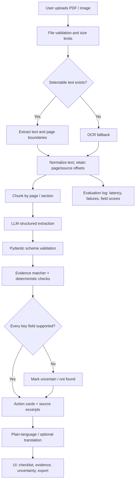

# Shinchan Online Hackathon 2026 — Winning Project Research

**Research snapshot:** 29 October 2026  
**Event:** Shinchan Online Hackathon — 24 Hour Hackathon by Devengers  
**Purpose:** Choose and execute one project that maximizes competitive potential in a 24-hour open-innovation event.  
**Evidence labels:** `[VERIFIED]` means directly supported by an official/event source; `[SOURCE-DERIVED]` means extracted from the supplied files; `[RESEARCH FINDING]` means supported by external research; `[INFERENCE]` is reasoned judgment; `[UNVERIFIED]` means not confirmed; `[RECOMMENDATION]` is the proposed course of action.

> **Decision in one sentence:** Build **Notice2Action — an evidence-linked, multilingual assistant that turns a confusing public-service notice or application document into a verified checklist of actions, deadlines, eligibility conditions, and missing information**. Keep the MVP narrow: upload one PDF/image, extract its text, produce structured action cards with page/paragraph evidence, and explain them in plain English plus one Indian language. The core advantage is not “chat with a PDF”; it is **traceable action extraction with visible evidence and uncertainty**.

---

## 1. Executive Summary

### 1.1 What matters for this event

The official organizer’s public post describes the event as **Open Innovation**, run online for 24 hours, from **31 October 2026 at 10:00 AM IST to 1 November 2026 at 10:00 AM IST**, with a separate submission deadline of **1 November at 5:00 PM IST**. It advertises a ₹60,000 total prize pool: ₹30,000 first prize, ₹20,000 second prize, and ₹10,000 third prize. It also says joining the official WhatsApp channel is mandatory because the Google Form submission link and updates will be shared there. These details are supported by the organizer’s public LinkedIn page, which is discoverable here: [Devengers official LinkedIn page](https://in.linkedin.com/company/officialdevengers). The provided Unstop event URL was not accessible to the web retrieval tool during this research; see Section 2 for what remains unverified.

**Important schedule implication:** the build window ends at 10:00 AM on 1 November, but the advertised submission deadline is 5:00 PM the same day. Treat 10:00 AM as the end of active development unless the organizers clarify otherwise. Do not use the extra five hours as an excuse to leave submission preparation until the last minute.

### 1.2 Why Notice2Action is the primary recommendation

Notice2Action combines the strongest practical themes in the supplied research—document intelligence, accessible Indian-language interfaces, evidence-grounded RAG, and evaluation—without taking on the data and deployment risks of more ambitious ideas.

It is deliberately narrower than a general government-scheme chatbot. A user uploads a notice, circular, scholarship instruction sheet, local-body notice, or application PDF. The system extracts the source text, identifies actions and requirements, attaches evidence snippets and page references, marks uncertain fields, and provides a plain-language explanation. The demo shows the original text beside each extracted action, so judges can check whether the AI is supported by the document.

### 1.3 Final decision

| Decision | Recommendation |
|---|---|
| **Primary project** | **Notice2Action** — evidence-linked multilingual notice-to-checklist assistant |
| **Backup project** | **LLMGuard Lite** — a small evaluation and prompt-injection test dashboard for RAG answers |
| Strongest reason | The user can see an end-to-end workflow, evidence citations, and a meaningful before/after improvement in seconds |
| Most dangerous risk | OCR or extraction errors may corrupt dates, amounts, or eligibility conditions |
| First action | Confirm the official submission channel and build a tiny test set of 8–12 public, non-sensitive documents before choosing the final UI |
| Win guarantee | None. This is a comparative strategic recommendation, not a statistical prediction of winning |

---

## 2. Hackathon Overview and Verified Requirements

### 2.1 Event details

| Item | Finding | Status / evidence |
|---|---|---|
| Event name | Shinchan Online Hackathon — 24 Hour Hackathon by Devengers | `[VERIFIED]` organizer announcement |
| Organizer | Devengers | `[VERIFIED]` organizer announcement |
| Platform | Powered by Unstop; online event | `[VERIFIED]` organizer announcement |
| Theme | Open Innovation | `[VERIFIED]` organizer announcement |
| Development window | 31 Oct 2026, 10:00 AM IST to 1 Nov 2026, 10:00 AM IST | `[VERIFIED]` organizer announcement |
| Submission deadline | 1 Nov 2026, 5:00 PM IST | `[VERIFIED]` organizer announcement |
| Prize pool | ₹60,000 total; ₹30,000 / ₹20,000 / ₹10,000 for first / second / third | `[VERIFIED]` organizer announcement |
| Extra rewards | Trophies, medals, goodies; free `.xyz` domains for top 50; achievement certificates for top 10; participation certificates for registered participants | `[VERIFIED]` organizer announcement |
| Mandatory communication channel | Join official WhatsApp channel to receive Google Form submission link and important updates | `[VERIFIED]` organizer announcement |
| Team size | **UNVERIFIED for this event** | Do not infer from other Devengers events |
| Individual participation | **UNVERIFIED for this event** | Confirm event page / organizer message |
| Eligibility | **UNVERIFIED in the retrieved announcement** | Confirm on Unstop or with organizer |
| Mandatory GitHub repository | **UNVERIFIED for this event** | Strongly recommended regardless |
| Mandatory deployment | **UNVERIFIED** | Prepare a live demo if feasible, but do not claim it is required |
| Mandatory PPT / video | **UNVERIFIED** | Prepare a short deck and demo video as insurance |
| Official judging weights | **UNVERIFIED** | Do not present weights below as official |
| AI-generated code / third-party APIs | **UNVERIFIED** | Keep attribution, original work, and setup instructions clear; ask organizer if policy is unclear |
| Exact submission fields | **UNVERIFIED** | The organizer says the Google Form is distributed through WhatsApp; inspect it as soon as available |

**Primary event source:** [Devengers official LinkedIn page and event announcement](https://in.linkedin.com/company/officialdevengers).  
**Provided Unstop event link:** [Shinchan Online Hackathon registration page](https://unstop.com/p/shinchan-online-hackathon-24-hour-hackathon-devengers-1771802). The retrieval system returned an access error for this URL, so details not visible in the organizer announcement are explicitly left unverified.

### 2.2 Verified Hackathon Requirements and Winning Constraints

1. **Open innovation:** choose a problem and domain rather than waiting for a fixed problem statement.
2. **Build inside the stated 24-hour window:** do not assume existing code can be submitted as if it was created during the event. Start a fresh repository at the event start and record progress in commits.
3. **Submission has its own deadline:** finish the core build by 10:00 AM on 1 November, then reserve the remaining time for testing, packaging, and submission—unless organizers explicitly say the coding window differs.
4. **WhatsApp channel is mandatory:** join it before the event, turn on notifications, and verify that you can access the form link.
5. **Jury verification is likely to depend on what you submit:** maintain a public GitHub repository with a useful README, screenshots, architecture, data provenance, and setup steps even if not explicitly required.
6. **Originality matters:** do not clone a tutorial or claim a general-purpose PDF chatbot as novel. The differentiator must be implemented and shown.
7. **Do not assume judging criteria or team-size rules from another Devengers event.** A previous HackDevengers event is not the same event.

### 2.3 Immediate organizer questions

Ask the organizer or check the official event page for:
- Whether solo participation is allowed and the permitted team-size range.
- Whether repository links, deployment links, a PPT, or a video are required.
- Whether code must be written strictly during the 24-hour window and how prebuilt templates / APIs / AI coding tools are treated.
- Whether judging criteria and weights are published.
- Whether the 10:00 AM development end and 5:00 PM submission deadline are both correct and whether any form fields have special requirements.

---

## 3. Rules, Constraints, and Provisional Judging Criteria

Since detailed official judging weights were not visible in the retrieved official source, the following is a **provisional model for internal decision-making only**. It is not claimed to be the event’s official rubric.

| Criterion | Weight | What strong evidence looks like |
|---|---:|---|
| Problem importance and clarity | 15% | One identifiable user and a painful, concrete workflow |
| Innovation / differentiation | 15% | A feature competitors can see and test, not merely a trendy stack |
| Technical implementation | 15% | A functioning extraction → reasoning → validation → UI pipeline |
| Functionality and reliability | 15% | Complete happy path plus tested failure states |
| Demo and UX clarity | 15% | A judge understands the value in the first 10–20 seconds |
| Measurable evaluation | 10% | Small labeled benchmark, baseline, and honest metric |
| Real-world impact | 10% | Clear user benefit and a credible path to field validation |
| Scalability / future potential | 5% | Reasonable next steps without pretending the MVP is production-ready |

**Scale:** 1–3 = weak; 4–6 = plausible but incomplete; 7–8 = strong; 9–10 = exceptional evidence-backed performance. Scores in this report are strategic estimates, not objective measurements.

### Practical constraints

- 24 hours is not enough for custom model training, deep partnerships, reliable nationwide coverage, and polished multi-agent orchestration.
- The user’s stated development setup includes Windows, 16 GB RAM, and an RTX 3050 Laptop GPU with 6 GB VRAM. Use CPU-friendly libraries and optional hosted inference; do not make the GPU mandatory.
- Internet, model APIs, deployment platforms, OCR downloads, and quotas can fail. A small local demo dataset and deterministic fallback are necessary.
- Use public, non-sensitive sample documents in the demo. Do not upload personal medical, identity, or financial documents.
- Keep the core feature complete before adding voice, multiple languages, authentication, history, analytics, or agents.

---

## 4. Analysis of the Three Reference Documents

The three supplied Markdown files were read in full as text, not only through their executive summaries. They contain **65 named project dossiers**: 25 in `AI_Hackathon_Project_Ideas_Research_2026.md`, 25 in `25_PROBLEM_FIRST_AI_INNOVATION_PROJECTS_2026.md`, and 15 in `ADVANCED_AI_HACKATHON_PROJECT_ROADMAP.md` (the roadmap also includes a separate VidScholar deep dive). These are idea catalogs, not verified evidence that every technical claim or project score is correct.

### 4.1 What each document contributes

#### A. `AI_Hackathon_Project_Ideas_Research_2026.md`

Strongest contribution: a broad, India-relevant product catalog and hackathon-oriented framing. Its named projects include CropSense Lite, VoiceDoc, SmartAQI, LegalAssist India, CodeReview Agent, EduPath, SafeCommute, AgriVoice, ScanSafe, GovSeek, SentinelNet, FactGuard, PredictaHealth, BuildMind, LLMGuard, FloodSense, ResumeAlign, DigitalTwin Manufacturing, IndicDoc, CricketIQ, PrivacyLens, UrbanPulse, ThinkTrace, AdaptLearn, and HealthAI Observatory.

Its executive recommendations prioritize AgriVoice, LLMGuard, and IndicDoc. For this particular event, those are useful starting points, but the document’s recommendation should not be accepted automatically: AgriVoice depends on current weather/market information and reliable localized agricultural guidance; LLMGuard risks looking like an engineering dashboard without a vivid user outcome; IndicDoc can be valuable but generic OCR + text-to-speech is easy to replicate. The winning adaptation should demonstrate one differentiated workflow and evaluation.

#### B. `25_PROBLEM_FIRST_AI_INNOVATION_PROJECTS_2026.md`

Strongest contribution: a problem-first lens and explicit attention to data, incumbent workflows, operational failure modes, and adversarial review. Its 25 dossiers span infrastructure (BridgeGuard-AI, HydroPulse-GNN, GridArc-µPMU, SafeSite-Edge), healthcare (SepsisWave-AI, HistoTriage-AI, MedRec-Resolver, AlarmGuard-ICU), agriculture and food systems (AgriSpore-Vision, ColdChain-Life, TerraNitrogen-AI, BarnSentry-AI, SiloSense-AI), climate (MethaneQuant-Sat, PyroCast-AI, UrbanCool-3D), public administration (BenefitGuard-AI), manufacturing (LegacySense-PdM, CausalLine-AI), software security (ReachGuard-SCA), research integrity (ReproduceAI-Bio, ReviewCochrane-AI), accessibility (SignFlow-AI, AccessDoc-UA), and SME finance (SME-CashGuard).

Its key lesson is valuable: solve a defined failure in an existing workflow, not a vague “AI for X” problem. However, several proposals require specialized sensors, expensive instrumentation, private institutional data, rigorous clinical validation, large scientific models, or physics-informed training that a solo 24-hour prototype cannot credibly deliver. The report’s technical ambition is not a reason to copy its most complex architectures into this event.

#### C. `ADVANCED_AI_HACKATHON_PROJECT_ROADMAP.md`

Strongest contribution: production-minded engineering—evaluation, guardrails, tracing, caching, structured outputs, trust boundaries, and scope control. Its 15 projects are ContextForge (self-correcting RAG), Sentinel (LLM gateway / AI firewall), ConstructSafe AI, CodeReview Agent, MemoAgent, DocuMind, SportSense, EvalHub, AgroScope, DataPilot, HealthSig, AccessLens, FlowForge, ThreatScope, and EdgeInfer; it also separately deep-dives VidScholar.

The document correctly emphasizes that engineering reliability matters more than simply calling an LLM. For the hackathon, use a small subset: structured extraction, evidence grounding, schema validation, logging, a baseline comparison, and explicit fallback behavior. Avoid trying to ship a full agent platform, gateway, vector-database stack, observability product, and multimodal interface at once.

### 4.2 Duplicate and overlapping concepts merged

| Unified concept | Names / source sections that overlap | What to retain | What to avoid in 24 hours |
|---|---|---|---|
| Document intelligence and accessible reading | IndicDoc, ScanSafe, DocuMind, AccessDoc-UA, AccessLens; plus LegalAssist India / GovSeek where document Q&A overlaps | OCR/text extraction, plain-language summary, evidence-linked actions, language support | General “chat with any file” positioning; perfect PDF/UA compliance |
| RAG reliability and evaluation | LLMGuard, HealthAI Observatory, ContextForge, EvalHub, ThreatScope / Sentinel | Retrieval/evidence checks, prompt-injection test cases, schema validation, simple evaluation dashboard | Multi-agent self-correction loops with no measurable benefit |
| Agriculture advisory | AgriVoice, CropSense Lite, AgroScope, AgriSpore-Vision, TerraNitrogen-AI | One crop + one local decision workflow; sources and uncertainty | National-scale real-time advice or disease prediction without field validation |
| Health document / signal support | VoiceDoc, ScanSafe, PredictaHealth, HealthSig, SepsisWave-AI, AlarmGuard-ICU, MedRec-Resolver | Administrative document reconciliation or offline benchmark visualization | Clinical claims, diagnosis, or live decision support without validation |
| Safety computer vision | ConstructSafe AI, SafeSite-Edge, SportSense (partial overlap in vision pipeline) | One visible object/zone detection task with a clear demo | Promising sub-100 ms safety intervention without measured hardware and latency |
| Code / security analysis | CodeReview Agent, SentinelNet, LLMGuard, ThreatScope, ReachGuard-SCA | One narrow analysis task, tests, and explainable findings | Claiming comprehensive vulnerability detection from a prototype |
| Environmental risk maps | SmartAQI, FloodSense, UrbanPulse, UrbanCool-3D, MethaneQuant-Sat, PyroCast-AI | A single public-data map with transparent assumptions | Complex physical forecasting without validated data and models |
| Analytics / forecasting | BuildMind, CricketIQ, DataPilot, SME-CashGuard, SmartAQI | Transparent calculation, benchmark, scenario comparison | Fake “real-time” local prices or predictive certainty without current data |

### 4.3 Critical audit of the supplied documents

1. **Do not accept all “research-backed” claims without checking the cited source and context.** Some project descriptions combine plausible engineering ideas with high-stakes performance claims that cannot be validated in a hackathon.
2. **Distinguish a paper architecture from an implementable MVP.** Neural operators, causal graph discovery, conformal stopping bounds, and multimodal foundation models may be research-worthy but are not automatically buildable in one day.
3. **Hardware claims require care.** A 6 GB GPU is useful for compact vision models and some quantized LLM inference, but performance depends on quantization, context length, runtime, and system memory. Do not promise comfortable inference for every 7B/8B model.
4. **“Real-time” data needs a real source.** AgriVoice, BuildMind, SmartAQI, and FloodSense become less credible if the demo uses invented live data but labels it real.
5. **A polished UI is not proof of AI quality.** Every recommended project needs a small labeled test set and a baseline.
6. **Novelty claims should be modest.** “Differentiated approach” is defensible; “globally unique” is not established by a quick search.
7. **Healthcare and safety systems need careful scope.** Prototype outputs should be educational or administrative support, not medical diagnosis or safety-critical commands.
8. **One coherent vertical slice beats a bundle of unrelated features.** Keep the project to one upload, one structured result, one evidence view, and one measured comparison.

### 4.4 Best concepts to carry forward

- Evidence-linked document extraction and accessible explanations (IndicDoc / ScanSafe / DocuMind).
- RAG evaluation and structured output validation (LLMGuard / ContextForge / EvalHub).
- A real user workflow rather than a generic assistant (GovSeek / LegalAssist India / BenefitGuard-AI).
- Clear uncertainty and a visible evidence trail.
- A baseline that exposes when the system is wrong.

---

## 5. Consolidated Project Inventory

This is a de-duplicated inventory of the 65 supplied dossiers, grouped by functional family. The names below preserve source terminology; the evaluation later in the report focuses on 18 distinct hackathon candidates rather than pretending every overlapping project is a separate innovation.

### 5.1 AI Hackathon Project Ideas Research (25 dossiers)

| Source project | Core problem / target user | AI / data approach | 24-hour feasibility | Main strength / weakness |
|---|---|---|---|---|
| CropSense Lite | Farmers identify crop disease from phone images | Image classifier; crop images; offline UI | Medium | Visual demo; field-domain shift risk |
| VoiceDoc | Rural clinic staff collect patient history in local languages | Speech-to-text + structured extraction | Medium | Human value; speech/noise and clinical privacy risks |
| SmartAQI | Residents need neighborhood air-quality context | Public sensor/weather data + forecasting | Medium | Map demo; hyperlocal data gaps |
| LegalAssist India | People struggle with legal documents | Document RAG and plain-language explanation | High for limited scope | Useful; legal hallucination risk |
| CodeReview Agent | Developers miss multi-file issues | Repository parsing + LLM review | Medium | Strong technical audience; common category |
| EduPath | Exam learners need gap diagnosis | Quiz results + skill mapping | High | Clear user journey; crowded EdTech space |
| SafeCommute | Communities need safer incident reporting | Privacy-preserving reporting + spatial patterns | Medium | Social value; sensitive data / safety risks |
| AgriVoice | Farmers need localized advice and market/weather context | RAG + weather/market APIs + multilingual UX | Medium-low | Strong domain relevance; dependency and accuracy risk |
| ScanSafe | Patients need help understanding medical documents | OCR + structured extraction + plain language | High for administrative-only scope | Clear upload demo; high-stakes interpretation risk |
| GovSeek | Citizens need to navigate schemes and services | Search/RAG over official sources | Medium-high | Local relevance; source freshness / eligibility risk |
| SentinelNet | Small teams need explainable network intrusion alerts | Network traffic features + anomaly detection | Medium | Technical depth; data and setup burden |
| FactGuard | Users need to check viral claims | Claim retrieval and evidence comparison | Medium | Timely; live verification is difficult |
| PredictaHealth | Hospital staff need early warning | Clinical time-series models | Low | High impact; validation and data risk |
| BuildMind | Home builders need local construction estimates | Quantity calculator + regional prices | Medium | Practical local pain; reliable prices and quantities are hard |
| LLMGuard | Developers need model/RAG evaluation and monitoring | Test sets, traces, prompt injection checks | High for narrow scope | Engineering credibility; can feel like a dashboard only |
| FloodSense | Residents need district-level flood alerts | Public weather/hazard data + risk map | Medium-low | Strong impact; live/local data risk |
| ResumeAlign | Job seekers need resume-to-role gap analysis | Parsing + structured matching | High | Easy demo; saturated |
| DigitalTwin Manufacturing | Small factories need quality/process insight | Sensor data + anomaly detection | Low-medium | Industrial depth; real data needed |
| IndicDoc | Visually impaired users need government docs read and explained | OCR + TTS + language transformation | High for narrow scope | Accessibility; differentiation needs evidence/action focus |
| CricketIQ | Fans need context-aware cricket analytics | Ball-by-ball data + statistical features | High if dataset prepared | Strong personal demo; niche |
| PrivacyLens | Teams need privacy-preserving ML demonstration | Federated-learning simulation | Medium | Good educational value; user benefit may be abstract |
| UrbanPulse | Cities need cross-modal monitoring | Vision + IoT + NLP | Low | Ambitious; integration scope too broad |
| ThinkTrace | Researchers need literature discovery | Semantic retrieval + graph | Medium | Good workflow; citation correctness matters |
| AdaptLearn | Students need adaptive assessment | Item-response theory + quiz results | Medium-high | Measurable; less visually distinctive |
| HealthAI Observatory | Teams need medical-model evaluation | Benchmarking + red-team tests | Medium | Responsible AI; requires careful non-clinical framing |

### 5.2 Problem-First AI Innovation Projects (25 dossiers)

| Source project | Core problem / target user | Main technical concept | 24-hour feasibility | Main risk |
|---|---|---|---|---|
| BridgeGuard-AI | Structural engineers assess bridge fatigue | Physics-informed neural operator + vibration telemetry | Very low | Instrumentation / labeled ground truth |
| HydroPulse-GNN | Utilities localize water leaks | Graph model + acoustic/hydraulic data | Very low | Real sensor/network data |
| GridArc-µPMU | Utilities detect arcing faults | High-rate synchrophasor streaming | Very low | Specialized hardware and data |
| SafeSite-Edge | Construction sites detect struck-by/fall hazards | Edge computer vision | Medium for prerecorded video | Latency and safety claims |
| SepsisWave-AI | Clinicians identify deterioration | Multimodal physiological time series | Low | Clinical validation / data |
| HistoTriage-AI | Pathology teams triage biopsies | Domain-adversarial vision model | Very low | Slides, compute, expert labels |
| MedRec-Resolver | Clinicians reconcile discharge text and prescriptions | Cross-document clinical NLP | Low-medium, administrative mock only | High-stakes medication errors |
| AlarmGuard-ICU | Reduce non-actionable ICU alarms | Multimodal waveform classification | Very low | Patient waveforms and labels |
| AgriSpore-Vision | Farmers forecast crop disease spread | Vision + spore/weather dynamics | Low | Field data and epidemiology |
| ColdChain-Life | Logistics teams estimate perishable shelf life | Arrhenius kinetics + sensor data | Low-medium | Calibration and temperature history |
| TerraNitrogen-AI | Farmers optimize fertilizer and emissions | Biogeochemical model + ML | Very low | Soil, crop, weather measurements |
| BarnSentry-AI | Farms detect animal disease early | Audio/vision edge monitoring | Low | Domain data / validation |
| SiloSense-AI | Grain operators detect silo hot spots | Thermal sensors + PDE/ML | Very low | Sensor data / physical model |
| MethaneQuant-Sat | Climate teams quantify methane plumes | Hyperspectral imagery + flux inversion | Very low | Specialized data / atmospheric modeling |
| PyroCast-AI | Emergency teams model wildfire/ember spread | Atmospheric-fire neural emulator | Very low | Compute / physical validation |
| UrbanCool-3D | Cities map pedestrian heat exposure | Microclimate estimation | Low-medium | Ground truth and spatial data |
| BenefitGuard-AI | Caseworkers prevent erroneous benefit denials | Semantic cross-document reconciliation | Medium for public-document prototype | Access to real administrative cases |
| LegacySense-PdM | Factories monitor old equipment | Self-supervised sensor analytics | Low-medium | Real vibration/audio data |
| CausalLine-AI | Manufacturers connect process conditions to defects | Graph causal discovery + image embeddings | Low | Synchronized industrial data |
| ReachGuard-SCA | Developers prioritize reachable dependency vulnerabilities | Call-graph analysis + dependency metadata | Medium | Language/runtime coverage |
| ReproduceAI-Bio | Researchers flag manuscript/statistical inconsistencies | NLP + deterministic statistical checks | Medium | False positives and domain complexity |
| ReviewCochrane-AI | Reviewers screen evidence faster | Active learning + uncertainty bounds | Medium | Needs labeled screening data |
| SignFlow-AI | Deaf users need continuous sign-language interpretation | Spatiotemporal vision | Low | Dataset / linguistic nuance |
| AccessDoc-UA | Publishers create accessible PDFs | Layout analysis + PDF tagging | Low-medium | PDF/UA compliance is complex |
| SME-CashGuard | Small businesses anticipate late payments | Probabilistic time-series model | Medium if synthetic/sample data labeled honestly | Private financial data |

### 5.3 Advanced AI Project Roadmap (15 dossiers + VidScholar deep dive)

| Source project | Core problem / target user | Main technical concept | 24-hour feasibility | Main risk |
|---|---|---|---|---|
| ContextForge | Researchers need more reliable answers over documents | Self-correcting RAG / reranking / evaluation | Medium for narrow corpus | Agent complexity and latency |
| Sentinel | Developers need a centralized LLM gateway | Routing, caching, guardrails, cost traces | Medium | Too much infrastructure to demo |
| ConstructSafe AI | Workers need visual hazard awareness | Real-time CV safety pipeline | Medium for video-only demo | Safety claims / detection errors |
| CodeReview Agent | Developers need cross-file review | Repo graph + LLM analysis | Medium | Generic output / repo parsing |
| MemoAgent | Agents need persistent memory | Episodic / semantic memory | Medium | Hard to prove value in a short demo |
| DocuMind | Users need document extraction and understanding | Multimodal document pipeline | High for limited formats | Common category |
| SportSense | Athletes need technique feedback | Pose estimation + video | Medium | Camera angles / measurement validity |
| EvalHub | Teams need RAG/LLM quality evaluation | Benchmark runner and scorecards | High | Needs compelling user workflow |
| AgroScope | Farmers need disease severity assessment | CV + severity tracking | Medium | Dataset / field generalization |
| DataPilot | Analysts query tables in natural language | NL-to-SQL with validation | High for one database | SQL safety and hallucinations |
| HealthSig | Clinicians interpret physiological signals | Signal processing + decision support | Low-medium | Clinical data and claims |
| AccessLens | Visually impaired users need visual assistance | Vision-language model + speech | Medium | API reliability / accessibility testing |
| FlowForge | Engineers orchestrate data pipelines | Agentic pipeline generation | Medium-low | Reliability and scope creep |
| ThreatScope | Developers test AI safety | Red-team cases + guardrails | High for narrow benchmark | Can become a generic checklist |
| EdgeInfer | Developers benchmark local small models | Inference / latency / memory benchmark | High | Less direct social impact |
| VidScholar (deep dive) | Learners need long-video intelligence | Transcript ingestion + RAG + chapter summaries | High if transcript is available | Similar products exist; video access restrictions |

---

## 6. Existing Products and Competitive Landscape

This section separates external research from inference. It is not a claim that every competitor has been exhaustively benchmarked.

### 6.1 Document OCR and document understanding

- **PaddleOCR** is an established open-source OCR/document-parsing toolkit. Its repository describes support for multilingual OCR and structured document parsing and lists an Apache-2.0 license: [PaddleOCR GitHub](https://github.com/PaddlePaddle/PaddleOCR). This means “we use OCR” is not the differentiator.
- **OCRmyPDF** adds an OCR text layer to scanned PDFs so they become searchable: [OCRmyPDF documentation](https://ocrmypdf.readthedocs.io/en/latest/). This also demonstrates that basic searchable-PDF conversion is already a solved component.
- Common PDF chat products already allow users to upload a document and ask questions. A project that only summarizes a PDF or adds a chat box is therefore likely to look incremental.

**Identified gap for this MVP:** produce a short, structured *action plan* with a source snippet/page reference for every material claim; distinguish extracted facts from inference; mark missing or conflicting information; and let the user inspect the original evidence. The innovation is the complete user workflow and its validation, not a new OCR algorithm.

### 6.2 RAG and model-evaluation tooling

RAG frameworks and observability products already provide retrieval, tracing, evaluation, and prompt debugging. A student project should not claim to invent RAG evaluation. A better demo is a narrow benchmark showing a measurable failure mode: for example, compare a plain generated summary with an evidence-linked extraction on a hand-labeled set of public notices.

**Identified gap:** an evaluation view that shows whether each action card is supported by a document passage and flags unsupported fields. That is a visible and testable differentiator.

### 6.3 Indian public-service information

Government portals and scheme directories already publish eligibility rules, forms, circulars, and notices. A general scheme chatbot risks stale data and incorrect eligibility guidance. Notice2Action instead treats the user’s uploaded source as the ground truth for the specific document and avoids claiming to determine official eligibility from general knowledge.

**Boundary:** the prototype is not an official government service and does not guarantee eligibility, legal correctness, or successful application outcomes. It helps the user understand a supplied document and prepare questions/checklists.

### 6.4 What to avoid copying

- Generic PDF chatbot with no citations.
- Generic “AI assistant for farmers” requiring live data but using mock data.
- AI resume optimizer without a defensible baseline.
- Broad “smart city” dashboards that stitch together unrelated charts.
- Healthcare prediction demos that report clinical accuracy without valid held-out evaluation.
- “Agentic” workflows where the agent’s extra steps are not measurable improvements.

---

## 7. New Opportunities Identified Through Research

The best opportunity is a synthesis of existing ideas rather than a claim of absolute novelty.

### Opportunity: “From document to next action, with proof”

A public notice often contains a mixture of eligibility conditions, required documents, dates, exceptions, contact information, and procedural instructions. A reader may understand the words but still not know what to do next. Notice2Action converts a source into a checklist, but every extracted action must be traceable to a passage.

**What already exists:** OCR, PDF chat, translation, summarization, and RAG are widely available components.

**What the prototype adds:** a structured action schema; evidence snippets and page numbers; uncertainty labels; a “show source” interaction; and a small test report comparing its outputs against a manually labeled set.

**Why the combination matters:** users do not only need a fluent explanation—they need to know which steps apply, what document is required, when action is due, and where the system got that information.

**Demo-able claim:** “For each action we show the exact text that supports it. If the document does not state a deadline, we say ‘not found’ instead of inventing one.”

### Alternative opportunities considered

1. **AgriVoice localized advisory:** high impact, but live market/weather integration and source reliability raise failure risk. Strong backup if a reliable dataset/API is ready.
2. **BuildMind local material estimator:** concrete user pain, but local prices, quantities, wastage, and taxes need reliable inputs. A fabricated “live market price” would undermine trust.
3. **LLMGuard Lite:** reliable and technically credible, but more developer-facing and less emotionally legible than an everyday user workflow.
4. **SafeSite-Edge / ConstructSafe:** strong visual demo, but safety claims require careful caveats and camera/video model performance may vary.
5. **CricketIQ:** data and visualization can be strong, but the social-impact story may be less immediate unless the event judges favor sports analytics.

---

## 8. Candidate Project Ideas

Eighteen genuinely distinct candidates are evaluated below. The categories are: A = adapted from the supplied documents; B = intelligent combination/reinterpretation; C = original proposals beyond the supplied catalogs. An “original proposal” means newly framed for this analysis, not a claim that no similar product exists anywhere.

### Strategy A — Adapted from the supplied documents

| ID | Candidate | User / problem | Proposed MVP | Three-minute demo |
|---|---|---|---|---|
| A1 | **AgriVoice Local** | Smallholder farmer needs an understandable answer about one crop problem | One crop, one district, curated verified source pack, question answering with source/date labels | Ask about a crop symptom; show answer, evidence, and “when to seek local expert help” |
| A2 | **LLMGuard Lite** | Developer needs to know whether a RAG app answers from evidence and resists prompt injection | Upload corpus + 10 test questions; show retrieval evidence, answer support, injection tests, failures | Run baseline and guarded mode; show unsupported answer caught |
| A3 | **IndicDoc Access** | User with low literacy/low vision needs an official PDF explained | OCR/text extraction, read-aloud, plain-language summary, page citations | Upload a public circular; listen/read; tap source evidence |
| A4 | **BuildMind Lite** | First-time home builder needs a rough material estimate | User inputs built-up area and specification assumptions; transparent quantities + editable local price sheet | Change area/specification; show estimate breakdown and assumptions |
| A5 | **ReachGuard Lite** | Small developer needs to prioritize dependency alerts | Parse a supported package manifest and explain dependency path; narrow language scope | Upload a sample manifest; show direct vs transitive dependency findings |

### Strategy B — Intelligent combinations or substantial reinterpretations

| ID | Candidate | Source concepts combined | Shared problem and new capability | Demo |
|---|---|---|---|---|
| B1 | **Notice2Action** *(primary)* | IndicDoc + ScanSafe + DocuMind + GovSeek + ContextForge / EvalHub | Turn a notice into a checklist with evidence, missing-field flags, and plain-language explanation | Upload a public notice; inspect action cards and source passages |
| B2 | **EvidenceFirst Legal Intake** | LegalAssist India + DocuMind + ContextForge | Help a community volunteer prepare a question list from a user-provided public/legal document without giving definitive legal advice | Upload a sample notice; see extracted dates, requirements, and unresolved questions |
| B3 | **TrustTrace for AI Answers** | LLMGuard + ContextForge + ThreatScope | A compact “why should I trust this answer?” inspector for one RAG corpus | Ask a question with insufficient evidence; system abstains and explains why |
| B4 | **Local Price Confidence Ledger** | BuildMind + DataPilot + uncertainty / provenance concepts | Let a user compare material estimates from a small manually curated price sheet with date/source/coverage labels | Change location/date and see known prices vs missing coverage, never fake live pricing |
| B5 | **Public Notice Change Detector** | DocuMind + EvalHub + document comparison | Compare two versions of a circular and highlight changed deadlines, amounts, requirements, and their page evidence | Upload two sample versions; show a side-by-side change report |
| B6 | **Accessible Form Companion** | IndicDoc + AccessLens + structured extraction | Guide a user through understanding one form’s fields and required supporting documents | Select a form field; show plain-language explanation and source |
| B7 | **RAG Regression Bench** | ContextForge + EvalHub + LLMGuard | Let developers compare two prompt/retrieval versions on a fixed question set | Show baseline vs revised version, evidence coverage, latency, and failure examples |

### Strategy C — Original proposals developed during this analysis

| ID | Candidate | User / problem | MVP | Demo |
|---|---|---|---|---|
| C1 | **RepairProof** | Tenant or homeowner struggles to turn repair photos/messages into a clear issue log | Photo + note timeline, structured issue/urgency labels, exportable report; no legal conclusions | Add a leaking-roof photo and message; export an evidence-based maintenance report |
| C2 | **QueueFair** | Small clinic or service desk needs transparent queue triage without exposing sensitive data | Synthetic queue data + deterministic priority rules + wait-time forecast | Add arrivals and see expected wait; explain each queue decision |
| C3 | **WasteSort Local** | Apartment residents need practical local waste-sorting guidance | Image/text item lookup over a small locality-specific ruleset | Ask how to dispose of a mixed item; show rule source and uncertainty |
| C4 | **ReceiptMismatch** | Small shop/bookkeeper wants to spot invoice vs receipt discrepancies | OCR plus deterministic line-item/amount/date comparison | Upload two sample documents; highlight mismatches with bounding/source evidence |
| C5 | **HeatRoute** | Pedestrians want a lower-heat walking route | Public weather + map data where available; transparent proxy score and shaded route assumptions | Compare two routes with heat/time trade-off; label proxy estimates |
| C6 | **SkillProof** | Student wants to connect course work to evidence-backed skills | Parse a project README and course outcomes; produce a skills evidence map, not a resume rewrite | Show skill claims linked to code artifacts and missing proof |
| C7 | **CivicSignal** | Residents need to turn a civic issue report into a structured, actionable submission | Image/text intake, issue category, location, evidence checklist, exportable complaint draft | Upload a pothole photo and description; generate a structured report and missing fields |

---

## 9. Comparative Evaluation Matrix

### 9.1 Scoring method

The matrix uses a simplified 1–10 scale and a provisional weighted score. Since official event weights are unverified, weights are internal decision aids. The simplified score emphasizes problem clarity (15%), differentiation (15%), technical execution (15%), reliability/feasibility (20%), demo clarity (15%), measurable validation (10%), and impact/scale (10%). “Dependency readiness” and “failure risk” are considered inside feasibility/reliability. Higher is better.

**Completion estimate** means a qualitative estimate that one developer could produce a working, presentable MVP in 24 hours if the required inputs are prepared; it is not a probability of winning.

| Rank | ID / candidate | Problem | Diff. | Tech | Feas. | Demo | Eval. | Impact | Weighted /10 | MVP completion outlook | Key weakness / dependency | Status |
|---:|---|---:|---:|---:|---:|---:|---:|---:|---:|---|---|---|
| 1 | B1 Notice2Action | 8 | 8 | 8 | 9 | 9 | 9 | 8 | **8.45** | High | OCR/date extraction errors; curated documents needed | **Primary** |
| 2 | B5 Public Notice Change Detector | 8 | 8 | 7 | 9 | 9 | 8 | 8 | **8.15** | High | Needs two comparable document versions | Shortlist |
| 3 | A2 LLMGuard Lite | 7 | 8 | 8 | 9 | 7 | 9 | 7 | **7.90** | High | Must show useful user-facing failure detection | **Backup** |
| 4 | B3 TrustTrace for AI Answers | 7 | 8 | 8 | 8 | 8 | 9 | 7 | **7.85** | High | Similar to existing RAG evaluation tools | Shortlist |
| 5 | A3 IndicDoc Access | 8 | 6 | 7 | 9 | 8 | 7 | 9 | **7.70** | High | Basic OCR + read-aloud is easy to copy | Shortlist |
| 6 | C4 ReceiptMismatch | 8 | 6 | 7 | 8 | 8 | 9 | 8 | **7.60** | High | OCR tables / layout errors |
| 7 | B6 Accessible Form Companion | 8 | 7 | 7 | 8 | 8 | 7 | 8 | **7.55** | High | Scope can expand across many form types |
| 8 | B4 Local Price Confidence Ledger | 8 | 8 | 7 | 7 | 8 | 8 | 8 | **7.55** | Medium-high | Must avoid presenting stale price data as live |
| 9 | A4 BuildMind Lite | 8 | 7 | 7 | 7 | 8 | 8 | 8 | **7.50** | Medium-high | Price data and estimate assumptions |
| 10 | A1 AgriVoice Local | 9 | 7 | 7 | 6 | 8 | 7 | 9 | **7.45** | Medium | Source freshness and agronomic reliability |
| 11 | B2 EvidenceFirst Legal Intake | 8 | 7 | 7 | 8 | 7 | 7 | 8 | **7.45** | High | Risk of being mistaken for legal advice |
| 12 | B7 RAG Regression Bench | 6 | 7 | 8 | 8 | 7 | 9 | 7 | **7.45** | High | Developer-facing; needs clear comparison |
| 13 | C7 CivicSignal | 8 | 7 | 6 | 9 | 8 | 6 | 8 | **7.45** | High | Needs a responsible complaint workflow |
| 14 | A5 ReachGuard Lite | 7 | 8 | 8 | 6 | 7 | 8 | 7 | **7.20** | Medium | Language ecosystem / call graph scope |
| 15 | C1 RepairProof | 7 | 7 | 7 | 8 | 8 | 6 | 7 | **7.20** | High | User validation and photo interpretation |
| 16 | C3 WasteSort Local | 7 | 6 | 6 | 9 | 7 | 7 | 7 | **7.10** | High | Local rules vary; curated source needed |
| 17 | C5 HeatRoute | 7 | 7 | 7 | 5 | 9 | 6 | 8 | **7.00** | Medium-low | Routing / weather / shade data dependencies |
| 18 | C6 SkillProof | 6 | 6 | 7 | 9 | 7 | 7 | 6 | **6.95** | High | Less urgent pain / crowded career tools |
| 19 | C2 QueueFair | 7 | 5 | 6 | 9 | 7 | 8 | 7 | **6.95** | High | Could be mostly deterministic rules |

*Scores are subjective strategic estimates. They are useful for prioritization, not empirical evidence.*

### 9.2 Why the top three outperform

- **Notice2Action** combines a recognizable problem, visible input/output, low setup burden, a trust-focused differentiator, and an evaluation path. Its output is useful even if the model is not perfect because it can show the source and mark uncertainty.
- **Public Notice Change Detector** has an excellent demo and deterministic comparison, but it depends on finding two versions of the same notice and may be narrower as a user product.
- **LLMGuard Lite** is highly feasible and measurable, but it may appear as an internal developer dashboard unless the failure case is exceptionally clear. It is the best backup because it does not depend on OCR or public-document interpretation.

### 9.3 Adversarial re-ranking

| Candidate | Strongest skeptical objection | Mitigation that must be built | Revised judgment |
|---|---|---|---|
| Notice2Action | “This is just a PDF summary with an LLM.” | No free-form summary as the core. Show action schema, exact evidence, source page, missing-data labels, and benchmark results | Remains #1 if evidence panel and evaluation work |
| Public Notice Change Detector | “Diffing two PDFs is already available.” | Compare semantic fields (deadline, amount, required documents) and link each change to the source page | Strong alternative, but requires paired documents |
| LLMGuard Lite | “This is a wrapper around a prompt-injection checklist.” | Run an explicit test suite and report baseline vs guarded outcomes, false positives, and evidence coverage | Best backup |
| IndicDoc Access | “OCR + text-to-speech already exists.” | Focus on task completion: explain requirements and build an evidence-linked checklist, not only read aloud | Fold into Notice2Action |
| BuildMind Lite | “Your prices are stale and your quantities are assumptions.” | Clearly version price inputs; show formulas and let the user edit them; never call static prices live | Valuable but more data risk |

---

## 10. Top Five Project Dossiers

### 10.1 #1 Notice2Action — Evidence-linked multilingual notice-to-checklist assistant

**One-line pitch:** “Upload a confusing public notice; get a plain-language checklist of what to do, what to bring, and when—each step linked to the exact source passage.”

- **Target user:** student, resident, first-time applicant, community volunteer, or low-literacy user trying to understand a public notice or application instruction.
- **Problem:** documents combine requirements, dates, exceptions, and process details in dense prose.
- **AI contribution:** extract structured fields and paraphrase them for the user; OCR handles scanned documents; a validator checks output schema and requires evidence text for each claim.
- **Not AI:** file validation, page counting, date normalization, evidence span lookup, missing-field flags, and score calculations should be deterministic.
- **Differentiator:** every action card includes “Why this step?” with the source text and page; missing deadlines are reported as “not found in the document.”
- **Evaluation:** on 8–12 public documents, manually label required documents, deadlines, eligibility conditions, and contact details. Measure field precision/recall, evidence-support rate, and abstention correctness.
- **Failure cases:** low-quality scan, tables split across pages, ambiguous dates, multiple contradictory dates, OCR language mismatch, irrelevant or malicious instructions inside a document.
- **Safety:** do not tell a user they are officially eligible or guarantee an application outcome. Make clear that the original notice and issuing authority are authoritative.

**Three-minute demo:** show a public circular; upload it; display extracted requirements; click one card to highlight its source text; demonstrate “deadline not stated” on a second document; show a tiny benchmark panel.

### 10.2 #2 LLMGuard Lite — RAG answer trust and injection test bench

**Pitch:** “Test whether a document-answering assistant actually uses its sources and safely handles malicious instructions inside retrieved text.”

- **User:** developer building a RAG app.
- **AI:** answer generation and optional semantic similarity; deterministic checks for citations, required fields, and known test outcomes.
- **Differentiator:** visible failure examples, not a generic dashboard.
- **Evaluation:** 10–20 hand-authored questions including answerable, unanswerable, conflicting-source, and prompt-injection cases. Report unsupported answer rate and abstention behavior.
- **Risk:** judges may see it as a developer tool with less direct user impact.
- **Fallback:** run tests over a local sample corpus; no external API is required if an available model or simple baseline can be used.

### 10.3 #3 Public Notice Change Detector

**Pitch:** “Show what actually changed between two versions of a notice, especially dates, amounts, eligibility rules, and required documents.”

- **User:** students, community workers, administrators.
- **AI:** extract structured fields and classify semantic changes; deterministic text diff as baseline.
- **Differentiator:** compare a semantic field diff with a raw text diff, and show evidence from both versions.
- **Evaluation:** manually label 10–20 changed fields across a small document pair set.
- **Risk:** finding true version pairs and handling layout shifts.
- **Why not primary:** the paired-document requirement adds avoidable setup risk.

### 10.4 #4 TrustTrace for AI Answers

**Pitch:** “Inspect the evidence behind an AI answer and detect when it is unsupported.”

- **User:** developer, analyst, or researcher.
- **AI:** retrieval and answer generation.
- **Deterministic checks:** source IDs, quoted evidence, schema validation, answerable/unanswerable test cases.
- **Differentiator:** evidence coverage and explicit abstention.
- **Risk:** overlaps strongly with RAG evaluation products; a compact, honest benchmark is essential.

### 10.5 #5 IndicDoc Access

**Pitch:** “Make official documents easier to read, listen to, and understand.”
- **User:** low-vision user or reader facing dense official prose.
- **AI:** OCR, plain-language transformation, optional translation/TTS.
- **Differentiator required:** connect each explanation to source text and turn it into an actionable checklist.
- **Risk:** basic OCR and read-aloud already exist, so accessibility alone is not enough to establish novelty.
- **Why folded into primary:** it strengthens Notice2Action’s accessibility without creating a separate product.

---

## 11. Adversarial Judge Review

### “Is this genuinely innovative?”
Not because OCR, summarization, or RAG are new. The differentiated product decision is to turn a notice into a source-linked action checklist with missing-field handling and a measured evidence-support score. Phrase novelty as a **differentiated workflow**, not a global invention claim.

### “Why is AI necessary?”
The system must handle varied phrasing, layouts, synonyms, and plain-language transformation across documents. Deterministic code should still handle date formatting, schema validation, source-span matching, and the benchmark. If a rule can solve a step reliably, do not use an LLM for it.

### “What if the model invents a date or requirement?”
Every action card requires a supporting excerpt. If the system cannot find evidence, it must mark the field “not found / needs human review.” Include an adversarial test where the source does not contain a deadline.

### “What if OCR is wrong?”
Display extracted text and original page side by side; show OCR confidence if the chosen engine provides it; allow manual correction for the demo. Report OCR errors as a limitation and never imply that low-quality scans are guaranteed to work.

### “What is the baseline?”
Baseline 1: keyword/rule extraction for dates and document lists. Baseline 2: unstructured LLM summary without evidence requirements. Compare the action fields and evidence support on the same labeled test set.

### “How do you know it works?”
Report measured field precision/recall and evidence-support rate on your small manually labeled test set. Do not invent accuracy. Show one correct extraction, one abstention, and one failure case.

### “What prevents a competitor from copying this?”
The feature can be copied. The near-term edge is execution: curated representative documents, a transparent evidence UX, failure handling, and a reproducible evaluation. Long-term defensibility would require user testing, localized document coverage, and integrations—not just a prompt.

### “Is this an official government product?”
No. It is a prototype that helps interpret a user-provided document. It does not determine official eligibility, submit applications, or replace the issuing authority.

### “What happens if the model API is down?”
Use a local sample corpus and a deterministic extraction fallback for dates/keywords. The UI should show “AI explanation unavailable; extracted source text is still available.” Do not fake a live call or silently show cached output as a fresh result.

### “What is the biggest weakness?”
OCR and field extraction can fail on scans, tables, handwriting, and ambiguous language. The MVP must narrow supported formats and expose uncertainty rather than claiming universal document understanding.

---

## 12. Final Project Selection and Backup

### Primary: Notice2Action

Build this if the team can get a working upload/extraction flow within the first 3–4 hours. Its strength is the combination of immediate user value, a visible evidence trail, and measurable quality.

### Backup: LLMGuard Lite

Switch to this if OCR/model setup is unstable after the initial timebox or if the chosen documents are too messy. It can use a local text corpus and a small test suite, preserving the core principle of evidence-grounded AI.

### Switch criteria

At hour 4, continue with Notice2Action only if:
- at least one PDF or image can be ingested;
- the extracted text is visible;
- one structured action can be returned;
- evidence excerpts can be shown next to the output.

If two or more fail, switch to LLMGuard Lite rather than spending the entire hackathon debugging OCR.

---

## 13. Problem Statement and Product Differentiation

### 13.1 Problem statement

People who must act on public notices and application instructions often need to extract multiple details—deadlines, eligibility conditions, required documents, submission steps, exceptions, and contact information—from dense documents. Generic summaries can omit a critical requirement and may state unsupported details.

### 13.2 Product promise

Notice2Action converts a supplied document into:
1. **Action checklist** — a clear, ordered list of what to do.
2. **Required documents** — named items with evidence.
3. **Dates and conditions** — normalized only when explicitly stated.
4. **Evidence panel** — original excerpt, page number, and extraction status.
5. **Plain-language explanation** — English plus one selected Indian language if the model can support it reliably.
6. **Uncertainty panel** — “not found,” “ambiguous,” or “needs human review.”

### 13.3 Explicitly out of scope

- Automatic submission to government portals.
- Official eligibility decisions or legal advice.
- Handwriting guarantees.
- Every Indian language on day one.
- Nationwide scheme search or live policy crawling.
- Login, user accounts, long-term document storage, analytics, multi-agent orchestration.
- Production claims about accessibility compliance.

### 13.4 Success criteria

These are **targets**, not results:
- Complete one PDF/image → action checklist → evidence view journey in under 60 seconds on a prepared demo document.
- Every displayed deadline and required-document claim includes a source excerpt or is marked uncertain.
- At least 8 public test documents with manually labeled fields.
- Measure field precision, field recall, evidence-support rate, and abstention correctness.
- Zero fabricated “live” sources or invented performance numbers in the demo.

---

## 14. System Architecture and Data Flow



### Architecture principles

- **One backend service:** FastAPI, not microservices.
- **No mandatory vector database:** for a single document, page/section retrieval can use text search and deterministic matching. Add embeddings only if the corpus grows.
- **Structured outputs:** use a Pydantic schema and reject invalid output.
- **Evidence before eloquence:** the UI should prioritize evidence and uncertainty over a fluent paragraph.
- **No autonomous external actions:** the system summarizes and prepares a checklist; the user decides what to do.
- **No training required:** use an existing model/OCR engine and evaluate the workflow.

---

## 15. Technology Stack and Model Selection

| Component | Recommendation | Why | Cost / credentials | Fallback |
|---|---|---|---|---|
| Frontend | Next.js + React + Tailwind CSS | Fast polished upload/result UI; matches preferred stack | Free/open source; no credentials | Streamlit for a faster single-process MVP |
| Backend | Python + FastAPI + Pydantic | Simple API, typed schema, validation | Free; no credentials | Single-process Python prototype |
| Text PDF extraction | PyMuPDF | Fast extraction from text PDFs | Open-source; review current license terms before distribution | `pdfplumber` |
| OCR | Tesseract via `pytesseract` or an available local OCR toolkit | Avoid relying on a paid API; supports image/scanned-document path | Free; install language packs | Demo on text PDFs plus clearly labeled sample OCR text |
| Optional OCR alternative | [PaddleOCR](https://github.com/PaddlePaddle/PaddleOCR) | Multilingual OCR/document parsing; Apache-2.0 repository license | Free/open source; setup may be heavy for a 24-hour window | Tesseract / text PDFs |
| LLM | Use a model/API already accessible and tested before event start; request strict JSON output | Avoid spending the event debugging a new provider | Provider-dependent; API key usually required | Rule-based extractor + preselected public text examples |
| Database | None for MVP; JSON/SQLite only if needed | No account/history requirement | Free | In-memory request processing |
| Deployment | Vercel for frontend; a simple Python host for FastAPI if already familiar | Quick shareable demo | Free-tier limits may change | Local demo + short screen recording; never claim it is deployed |
| Evaluation | Python script + labeled JSON/CSV | Reproducible metrics | Free | Manual review table if time is short |
| Logging | Python logging; record latency and error type without storing sensitive content | Useful failure analysis | Free | Console logs |

**Model selection rule:** choose the model that returns valid structured JSON and follows evidence constraints consistently on the actual test documents. Do not select a model because its benchmark or parameter count sounds impressive. Test at least five representative inputs before committing.

**GPU:** not required for the MVP. The RTX 3050 can be useful for local inference, but do not make successful deployment depend on loading a large model into 6 GB VRAM.

---

## 16. Data Sources, Licensing, and Evaluation

### 16.1 Demo data strategy

Use 8–12 publicly accessible, non-sensitive documents that cover:
- a notice with a clear deadline;
- a notice with required supporting documents;
- a document with eligibility conditions;
- a notice with no explicit deadline;
- a multi-page document;
- a scanned/image-based document;
- one document with ambiguous or conflicting dates, if a real public example can be found.

Prefer official public documents from government, education, scholarship, municipal, or public-service websites. Record the issuing organization, source URL, access date, and document title in `data/manifest.csv`. Respect source terms and copyright; for a hackathon demo, use only what is needed and link back to the original. Do not put personal data in the repository.

**No source URLs are asserted here as a ready-made dataset.** Collect and verify the specific documents before the event. If a document’s public status or license is unclear, use it only for private testing or choose another source.

### 16.2 Ground-truth annotation

Create `data/labels.json` with manually verified fields for each document:
- `document_id`
- `actions[]`
- `required_documents[]`
- `deadlines[]`
- `eligibility_conditions[]`
- `contact_details[]`
- `evidence_page`
- `evidence_quote`
- `field_status` (`present`, `not_found`, `ambiguous`)

Manually label at least 8 documents; 12 is better if time allows. The ground truth is a small prototype benchmark, not a representative national evaluation.

### 16.3 Metrics

- **Field precision:** correct extracted fields / all fields the system extracted.
- **Field recall:** correct extracted fields / all labeled fields that should have been extracted.
- **Evidence-support rate:** material output fields with a valid supporting source excerpt / all material output fields.
- **Abstention correctness:** cases where the source lacks a field and the system correctly says “not found” / all labeled absent-field cases.
- **Latency:** time from upload to rendered result.
- **Failure rate:** requests that error or return invalid schema / total test requests.

Compare:
1. **Baseline A:** simple keyword/date regex and document-list rules.
2. **Baseline B:** unstructured LLM summary without evidence constraints.
3. **Notice2Action:** structured extraction + evidence requirement + validation.

Do not invent a target score in the final presentation. Report the measured score, test-set size, and limitations.

### 16.4 Licensing and privacy

- Use public documents with a recorded source URL and date.
- Review the license of any code/model you redistribute; the PaddleOCR repository lists Apache-2.0, but model weights and dependencies should still be checked individually.
- Do not store uploaded files by default. Delete temporary files after processing.
- Do not include secrets in Git. Commit `.env.example`, not `.env`.
- Add a notice: “Prototype only. Verify requirements with the issuing authority. Not an official service.”

---

## 17. Repository Structure and API Design

### 17.1 Repository layout

```text
notice2action/
├── backend/
│   ├── app/
│   │   ├── main.py
│   │   ├── schemas.py
│   │   ├── services/
│   │   │   ├── extract_text.py
│   │   │   ├── ocr_service.py
│   │   │   ├── action_extractor.py
│   │   │   ├── evidence_matcher.py
│   │   │   └── evaluation.py
│   │   └── config.py
│   ├── tests/
│   │   ├── test_schema.py
│   │   ├── test_evidence.py
│   │   └── test_api.py
│   └── requirements.txt
├── frontend/
│   ├── app/
│   ├── components/
│   │   ├── UploadPanel.tsx
│   │   ├── ActionCard.tsx
│   │   ├── EvidencePanel.tsx
│   │   └── UncertaintyBadge.tsx
│   └── package.json
├── data/
│   ├── samples/
│   ├── manifest.csv
│   └── labels.json
├── eval/
│   ├── run_eval.py
│   └── results_template.csv
├── docs/
│   ├── architecture.md
│   └── demo-script.md
├── .env.example
├── .gitignore
└── README.md
```

### 17.2 Essential API

#### `POST /api/analyze`

Request: `multipart/form-data` with `file` and optional `language` (`en`, `hi`, or one tested language).

Response schema (illustrative contract, not a measured result):

```json
{
  "document_id": "demo-001",
  "extraction_method": "text_pdf",
  "language": "en",
  "actions": [
    {
      "title": "Submit the application form",
      "description": "Complete the form and submit it using the method stated in the notice.",
      "due_date": null,
      "status": "supported",
      "evidence": {
        "page": 2,
        "quote": "Applications must be submitted through ..."
      }
    }
  ],
  "required_documents": [],
  "eligibility_conditions": [],
  "uncertainties": [
    {
      "field": "deadline",
      "reason": "No explicit final date was located in the extracted text."
    }
  ],
  "disclaimer": "Prototype only. Verify with the issuing authority."
}
```

#### `GET /api/health`

Returns service status and the configured extraction/model mode. Do not expose API keys or environment variables.

#### `POST /api/evaluate`

Optional developer-only endpoint that runs the fixed benchmark and returns field precision/recall, evidence-support rate, abstention correctness, latency, and failures.

### 17.3 Input validation and error states

- Accept only PDF, PNG, and JPEG for the first MVP.
- Enforce file size and page-count limits.
- Reject empty files, unsupported types, and encrypted PDFs with a clear message.
- Handle zero extracted text and OCR failure explicitly.
- If model output fails schema validation, retry once at most; then return a controlled error or fallback extraction.
- Never render an unsupported deadline as a confident date.
- Keep loading, success, partial success, and failure states visible.
- Show “evidence not found” rather than an empty citation.

### 17.4 Main UI screens

1. **Landing/upload:** short pitch, supported file types, privacy note, sample document button.
2. **Processing:** explicit stages—extracting text, finding requirements, validating evidence.
3. **Results:** summary strip + action cards + required-document list + deadlines.
4. **Evidence drawer:** original text, page number, quote, and status for each claim.
5. **Evaluation view:** labeled test-set metrics and baseline comparison.
6. **About/limitations:** model used, data source, known failure cases, and prototype disclaimer.

---

## 18. Twenty-Four-Hour Execution Schedule

**Planning assumption:** one developer. If teammates are allowed and available, divide frontend, backend, data/evaluation, and presentation work. Confirm team rules first.

| Time | Phase | Exact tasks | Definition of done | Risk / fallback |
|---|---|---|---|---|
| 10:00–10:45 | A. Setup | Join WhatsApp; read rules/form; create repo; Python env; test model/API and PDF extraction | `/health` works; one sample file extracts | If provider setup fails, use a tested local/rule-based path |
| 10:45–12:30 | B. Core workflow | Upload route; extract text; preserve page boundaries; display extracted text | One PDF upload works end-to-end | Start with text-based PDFs, then add OCR |
| 12:30–14:00 | C. AI extraction | Pydantic schema; prompt; action/doc/date/condition fields; evidence quote | One document yields valid structured output | Remove optional translation and limit to one document type |
| 14:00–15:00 | D. Evidence validation | Match evidence quotes to extracted source; add “not found” and ambiguity states | Unsupported fields are downgraded or rejected | Exact substring matching first; fuzzy matching only if needed |
| 15:00–16:30 | E. Frontend integration | Upload screen, loading state, action cards, evidence drawer, errors | Judge can use it without terminal commands | Simplify styling; do not rebuild design system |
| 16:30–17:30 | F. Differentiator | Plain-language rewrite + one tested language; “show source” interaction | Evidence-backed checklist is visually clear | Keep English only if translation quality is weak |
| 17:30–18:30 | D. Evaluation | Label 8–12 docs; run baseline and system; calculate metrics | Results CSV and limitations documented | Use 8 carefully labeled docs rather than fake larger metrics |
| 18:30–19:30 | G. Reliability | Invalid files, missing deadline, OCR failure, model timeout, malformed JSON | No unhandled errors on critical paths | Add deterministic fallback and error messages |
| 19:30–20:30 | H. UI polish | Typography, spacing, example document, evidence visual hierarchy | First 10 seconds communicate value | Remove nonessential animation |
| 20:30–21:30 | I. Deployment / demo setup | Deploy only if tested; configure environment; verify URL from fresh browser | A second device/session can open demo | Local demo + screen recording if hosting fails |
| 21:30–22:15 | J. Documentation | README, architecture, source manifest, run commands, screenshots | Repo is understandable to a judge | Keep README concise and accurate |
| 22:15–23:00 | K. Demo rehearsal | Run timed demo 3 times; prepare backup document and screenshots | Demo under 3 minutes, no untested steps | Use a real live inference or label any cached result honestly |
| 23:00–24:00 | L. Buffer / finish | Fix only critical bugs; freeze features; final push; prepare submission fields | Clean commit, app opens, submission details ready | No new features in final hour |

The schedule is expressed as elapsed time from the event start. The event announcement gives a separate 5:00 PM submission deadline after the 24-hour build window. By 10:00 AM on 1 November, the build should be frozen. Use the remaining advertised time for final checks and submission only, unless official instructions say otherwise.

### If you are solo

- Keep one branch and commit after each working vertical slice.
- Use `README.md` and a checklist to avoid context switching.
- No login, no user-history database, no agent framework, no training.
- At the 4-hour checkpoint, use the switch criteria in Section 12.

---

## 19. Risk Register and Fallback Plan

| Risk | Likelihood | Impact | Early warning | Mitigation / fallback |
|---|---|---|---|---|
| Unstop page inaccessible / rules unclear | Medium | High | No team/submission details available | Join organizer WhatsApp and ask before event; do not infer rules |
| Model API quota / outage | Medium | High | Timeout, 429, invalid key | Test before event; local sample path; deterministic fallback |
| OCR extraction failure | Medium-high | High | Garbled text or empty extraction | Support text PDFs first; keep OCR optional; expose raw extracted text |
| Invented or unsupported date | Medium | High | Output date has no source quote | Require evidence; if no quote, set null / uncertain |
| UI too broad | High | Medium | More than one main user journey | Freeze scope to one upload → checklist → evidence |
| Evaluation takes too long | Medium | High | No labeled samples by hour 16 | Start labels early; target 8 high-quality documents |
| Deployment breaks | Medium | Medium | Environment mismatch | Freeze a local demo and record a truthful backup video |
| Poor translation | Medium | Medium | Requirement changes meaning | English first; only enable one language after manual review |
| Data/licensing issue | Low-medium | High | Unclear source permissions | Prefer official public documents; cite source and avoid redistributing questionable files |
| Privacy leak | Low-medium | High | Uploaded personal documents retained | Use public demo files; no persistence; delete temp files |
| Overclaiming novelty/accuracy | Medium | High | Pitch says “100% accurate” or “first ever” | Present actual test size, metrics, failure cases, and limitations |

### Fallback ladder

1. **Preferred:** text PDF + LLM structured extraction + evidence checks.
2. **Fallback 1:** text PDF + deterministic extraction + LLM explanation.
3. **Fallback 2:** preselected public sample documents + live processing, clearly labeled as samples.
4. **Fallback 3:** switch to LLMGuard Lite using a local text corpus and fixed test cases.
5. **Emergency:** polished local application and honest recorded demo; do not fake a deployment or live model call.

---

## 20. Three-Minute Demo Script

Use a public, non-sensitive notice that contains requirements and a date. The exact document should be chosen and tested before the event. Any example output below is illustrative until measured.

| Time | Screen / action | What to say |
|---|---|---|
| 0:00–0:15 | Show the original dense notice, zoomed out | “A notice can contain a deadline, eligibility rules, and several required documents. A generic summary can miss the one detail a user needs to act.” |
| 0:15–0:35 | Upload the PDF; show processing stages | “Notice2Action extracts the source, identifies action items, and checks whether each item has evidence.” |
| 0:35–1:05 | Show checklist cards and required documents | “Instead of a paragraph, the user gets a concrete checklist. Dates are normalized only when the source states them.” |
| 1:05–1:35 | Click a card; show page and exact quote | “This is the key difference: every material instruction is linked to the source passage. The user can verify it.” |
| 1:35–1:55 | Show a document with no explicit deadline or an intentionally ambiguous example | “When the deadline is absent or ambiguous, the system does not invent one. It flags the gap for human review.” |
| 1:55–2:25 | Show evaluation panel: baseline vs Notice2Action | “We evaluated a small labeled set and report field precision/recall, evidence support, and abstention behavior. These are measured results from this run, not claims about every document.” |
| 2:25–2:45 | Show plain-language / tested language option | “Accessibility is part of the workflow: the same requirement can be explained more simply, while the original source remains available.” |
| 2:45–3:00 | Show limitations and close | “This is not an official eligibility decision. It is a traceable document-to-action assistant designed to reduce confusion without hiding uncertainty.” |

### Demo reliability checklist

- Use a tested document that works offline.
- Keep a second document ready to show “deadline not found.”
- Do not depend on live web search during the demo.
- Do not use a cached output while claiming it is fresh inference.
- Open the app in a clean browser before judges arrive.
- Keep a screenshot or video as backup, clearly distinguish it from the live run.
- Never show personal IDs, bank statements, medical records, or private data.

---

## 21. UI and Presentation Strategy

### Visual hierarchy

1. **Top line:** “Turn a notice into a checklist you can verify.”
2. **Upload panel:** file types, sample button, privacy note.
3. **Action summary:** action count, dates found, missing fields.
4. **Action cards:** action title, short explanation, deadline if explicitly supported, evidence status.
5. **Evidence drawer:** source excerpt, page number, “open original.”
6. **Uncertainty panel:** missing, ambiguous, or low-confidence details.
7. **Evaluation card:** test-set size, metrics, baseline comparison.
8. **Limitations:** visible and concise.

### Design rules

- Use a clean light theme, accessible contrast, large type, and clear labels.
- Use icons sparingly; do not encode meaning by color alone.
- Put evidence next to the claim it supports.
- Use plain language rather than AI jargon.
- Show a source badge such as “Supported by page 2,” not an unsupported confidence percentage.
- Do not use “verified” to mean the issuing authority itself has verified the AI output; label it “source-linked” or “evidence found.”
- Avoid decorative chatbot bubbles. The core UI is a checklist and evidence viewer.

### Suggested slide deck (only if useful or required)

1. Problem and user.
2. Workflow: document → extraction → action checklist → evidence.
3. Live demo and differentiator.
4. Evaluation and baseline.
5. Limitations, deployment status, and next steps.

---

## 22. Likely Judge Questions and Defensible Answers

**Q: Who has this problem?**  
A: People who need to act on public notices or application instructions but struggle to locate deadlines, conditions, and required documents. The prototype targets this workflow; user interviews are still needed to quantify the pain.

**Q: Why now?**  
A: OCR and language models make document processing more accessible, but fluent summaries can still hide unsupported claims. The product focuses on traceability and actionable output.

**Q: Why AI instead of regex?**  
A: Rules are used for dates and validation where possible. AI helps interpret varied phrasing and produce plain-language explanations. We compare against a deterministic baseline rather than assuming AI is always better.

**Q: What is novel?**  
A: We do not claim to invent OCR or RAG. The differentiated workflow is structured action extraction with per-field source evidence, missing-field abstention, and an evaluation panel.

**Q: What data did you use?**  
A: Public documents listed in the repository’s manifest, with source URLs and access dates. We manually labeled a small test set. No private user documents are required for the demo.

**Q: How was it evaluated?**  
A: On a small labeled test set, using field precision/recall, evidence-support rate, abstention correctness, latency, and failures. The repository contains the measured outputs. The test set is too small to claim broad generalization.

**Q: How do you prevent hallucinations?**  
A: Each important field must include a source excerpt; deterministic validation checks whether evidence exists. Unsupported fields are marked uncertain or not found. This reduces risk but does not guarantee correctness.

**Q: What happens with a bad scan?**  
A: We show extracted text and flag extraction failures. The MVP is strongest on text PDFs; OCR support is best-effort and does not guarantee handwriting or low-quality scan accuracy.

**Q: How much does it cost?**  
A: The application stack is open source. If a hosted model API is used, inference cost depends on the selected provider and usage; we will disclose the provider and measured usage rather than invent a universal cost.

**Q: Is the deployment production-ready?**  
A: No. It is a hackathon prototype with a small evaluation set, limited document types, and human verification required.

**Q: Can it scale?**  
A: The pipeline can be extended with document queues, stronger OCR, a versioned corpus, audit logs, and user testing. Those are future steps, not current capabilities.

**Q: What happens if the model fails?**  
A: The UI preserves the extracted text and returns a controlled error or deterministic fallback. It does not silently replace a failed live result with a cached one.

**Q: What prevents a company from copying it?**  
A: The feature is reproducible. Long-term value would come from trusted localized document coverage, careful evaluation, user feedback, and integration into real application workflows—not from the prompt alone.

**Q: Is this official advice?**  
A: No. It is a source-grounded interpretation aid. Users must verify with the issuing authority before taking consequential action.

---

## 23. Submission Checklist

### Before the event
- [ ] Join the official WhatsApp channel and verify access.
- [ ] Re-check the official Unstop page and organizer updates.
- [ ] Confirm team-size and solo-participation rules.
- [ ] Confirm required submission fields and policy on prebuilt code / AI coding tools.
- [ ] Prepare the development environment and test a PDF parser.
- [ ] Prepare public demo documents and a source manifest.
- [ ] Create a blank repository, but do not misrepresent pre-event work as event-built code.

### During the 24-hour window
- [ ] Commit the initial project and meaningful milestones.
- [ ] Complete one end-to-end workflow before adding features.
- [ ] Test missing deadline, invalid file, OCR failure, malformed model output, and API timeout.
- [ ] Record actual evaluation metrics and test-set size.
- [ ] Keep `.env` and secrets out of Git.
- [ ] Add README, architecture diagram, screenshots, and exact setup instructions.
- [ ] Make limitations and data sources explicit.

### Before 10:00 AM on 1 November
- [ ] Freeze feature development.
- [ ] Push final working code.
- [ ] Test the deployed app from a clean browser, if deployed.
- [ ] Verify the public repository and README.
- [ ] Record a backup demo video if allowed.
- [ ] Prepare the exact project description and links.

### Before the 5:00 PM submission deadline
- [ ] Open the Google Form from the official channel.
- [ ] Fill every required field carefully.
- [ ] Confirm all links are accessible without login.
- [ ] Submit before the deadline.
- [ ] Save confirmation evidence.
- [ ] Re-check organizer updates; do not assume the form is unchanged.

---

## 24. Final Recommendation

Build **Notice2Action** as an evidence-linked multilingual notice-to-checklist assistant.

It is the strongest choice because:
1. **The value is instantly visible:** a dense document becomes a checklist.
2. **The differentiator is defensible and testable:** every important action links to evidence, and missing information is surfaced rather than invented.
3. **It is feasible within 24 hours:** a single FastAPI service, a lightweight frontend, existing extraction tools, structured model output, and a small benchmark are enough.

**Backup:** LLMGuard Lite if OCR or document extraction is unstable after the first four hours.

**Largest unresolved risk:** extraction errors on scans, tables, and ambiguous language. Mitigate with text-first support, evidence checks, a narrow test corpus, and explicit uncertainty.

**First implementation action:** create the public-document test set and ground-truth labels, then prove the PDF → text → structured action → source evidence path before polishing the UI.

**Do not build:** a generic chatbot, nationwide scheme search, a multi-agent architecture, or a claim of perfect accuracy. Build one complete workflow and show the evidence.

---

## 25. Research Limitations and Unverified Assumptions

1. The provided Unstop page could not be retrieved by the web tool. Event timing, theme, prize information, and mandatory WhatsApp instructions were verified from the organizer’s public LinkedIn announcement, but other rules remain unverified.
2. Official team-size, solo participation, eligibility, repository, deployment, PPT/video, AI-code policy, and judging weights were not confirmed. Check the event page and WhatsApp updates before making any assumption.
3. The project scores are strategic judgments, not measured competitor rankings or actual win probabilities.
4. The three reference documents contain research and project proposals, but their individual empirical claims were not all independently re-verified in this report. They are treated as inputs, not unquestionable evidence.
5. No user interviews or field tests have been conducted for Notice2Action. User need is plausible but should be validated with a few short interviews if time permits.
6. No accuracy, latency, cost, or user outcome is claimed until measured on the implemented prototype.
7. Public-document availability and reuse rights must be checked for each specific document selected.
8. Translation quality varies by model and language. Enable only a language that passes manual review on the test documents.

---

## 26. References and Source Links

### Event and organizer
- [Devengers official LinkedIn page — includes the Shinchan Online Hackathon announcement](https://in.linkedin.com/company/officialdevengers)
- [Provided Unstop registration / event page](https://unstop.com/p/shinchan-online-hackathon-24-hour-hackathon-devengers-1771802) — not retrievable during this research; check manually.

### OCR / document processing
- [PaddleOCR repository](https://github.com/PaddlePaddle/PaddleOCR) — multilingual OCR and document parsing; repository lists Apache-2.0 license.
- [OCRmyPDF documentation](https://ocrmypdf.readthedocs.io/en/latest/) — adds an OCR text layer to scanned PDFs.

### Source documents supplied by the user
- `AI_Hackathon_Project_Ideas_Research_2026.md` — 25 project ideas, competition analysis, evaluation matrix, and top recommendations.
- `25_PROBLEM_FIRST_AI_INNOVATION_PROJECTS_2026.md` — 25 problem-first dossiers, comparative ranking, and adversarial review.
- `ADVANCED_AI_HACKATHON_PROJECT_ROADMAP.md` — 15 advanced project dossiers plus VidScholar deep dive, engineering roadmap, and hackathon execution guidance.

---

## 27. Appendix: Source-Document Traceability

| Recommendation / concept in this report | Source trace |
|---|---|
| Notice2Action: accessible document-to-action workflow | Adapted synthesis of `AI_Hackathon_Project_Ideas_Research_2026.md` Project 19 IndicDoc, Project 9 ScanSafe, Project 10 GovSeek; `ADVANCED_AI_HACKATHON_PROJECT_ROADMAP.md` Project 6 DocuMind and Project 1 ContextForge; `25_PROBLEM_FIRST_AI_INNOVATION_PROJECTS_2026.md` Project 17 BenefitGuard-AI and Project 24 AccessDoc-UA |
| Evidence-linked RAG and abstention | `ADVANCED_AI_HACKATHON_PROJECT_ROADMAP.md` ContextForge, EvalHub, ThreatScope; `AI_Hackathon_Project_Ideas_Research_2026.md` LLMGuard and HealthAI Observatory |
| Public Notice Change Detector | Substantial reinterpretation of DocuMind + EvalHub + document comparison; not a separately named project in the source catalogs |
| LLMGuard Lite backup | `AI_Hackathon_Project_Ideas_Research_2026.md` Project 15 LLMGuard and Project 25 HealthAI Observatory; `ADVANCED_AI_HACKATHON_PROJECT_ROADMAP.md` Projects 8 EvalHub and 14 ThreatScope |
| AgriVoice Local candidate | `AI_Hackathon_Project_Ideas_Research_2026.md` Project 8 AgriVoice; overlaps with CropSense Lite and AgroScope / AgriSpore-Vision |
| BuildMind Lite candidate | `AI_Hackathon_Project_Ideas_Research_2026.md` Project 14 BuildMind; simplified for 24-hour data feasibility |
| ReachGuard Lite candidate | `25_PROBLEM_FIRST_AI_INNOVATION_PROJECTS_2026.md` Project 20 ReachGuard-SCA |
| SafeSite / CV safety alternative | `ADVANCED_AI_HACKATHON_PROJECT_ROADMAP.md` Project 3 ConstructSafe AI; `25_PROBLEM_FIRST_AI_INNOVATION_PROJECTS_2026.md` Project 4 SafeSite-Edge |
| General engineering principles | `ADVANCED_AI_HACKATHON_PROJECT_ROADMAP.md` sections on evaluation, trust boundaries, structured outputs, security, observability, and execution; problem-first workflow principle from the 25-project report |
| Original proposals C1–C7 | New proposals developed for this analysis; not claimed to be globally unique |

---

**End of report.**
