# GapLens

**See what’s missing. Verify what matters.**

GapLens is an AI-assisted research workspace that turns a question into a structured, source-grounded investigation. It helps a researcher set scope, gather and extract sources, inspect claims and evidence, spot coverage gaps and conflicting claims, and plan verification work.

> Research support, not an authority. Review original sources and verify consequential claims before relying on them.

## What it does

- Turns a research question into an editable goal and set of research dimensions.
- Searches the web and accepts user-provided URLs and documents.
- Extracts source text, creates chunks, and uses an LLM to extract source-linked claims.
- Analyzes dimension coverage, evidence status, freshness, and possible contradictions.
- Prioritizes information gaps and creates a verification checklist.
- Persists sessions and results in SQLite for local development and demos.

The frontend is a set of static HTML screens served by FastAPI. There is no separate frontend build or Node server.

## Screens

| Screen | Route |
| --- | --- |
| Research home | `/research/new` |
| Scope review | `/research/{session_id}/scope` |
| Research progress | `/research/{session_id}/progress` |
| Research intelligence | `/research/{session_id}/intelligence` |
| Evidence explorer | `/research/{session_id}/evidence` |
| Verification workspace | `/research/{session_id}/verification` |

## Quick start

Requirements: Python 3.10+ (the project uses modern Python typing syntax), pip, and API credentials for whichever external providers you plan to use.

```powershell
cd backend
python -m venv .venv
.\.venv\Scripts\Activate.ps1
python -m pip install -r requirements.txt
Copy-Item .env.example .env
```

Edit `backend/.env` and add provider keys. For a useful full research run, configure an LLM key (`GEMINI_API_KEY` or `GROQ_API_KEY`) and a search provider key. The defaults select Gemini and Jina Search. Jina Reader can fetch submitted URLs without a key, subject to the provider’s lower unauthenticated limits.

Start the app from `backend/`:

```powershell
uvicorn app.main:app --reload --port 8000
```

Open [http://127.0.0.1:8000](http://127.0.0.1:8000). Interactive API docs are at `/docs`; health and provider readiness are reported by `/health`.

On macOS/Linux, use `python -m venv .venv`, `source .venv/bin/activate`, and `cp .env.example .env` in place of the PowerShell commands.

## Configuration

Settings are loaded from environment variables or `backend/.env`. See [`backend/.env.example`](backend/.env.example) for the complete list.

| Variable | Purpose |
| --- | --- |
| `LLM_PROVIDER` | Primary structured-output model provider: `gemini` or `groq` |
| `GEMINI_API_KEY`, `GROQ_API_KEY` | Provider credentials; configured provider may fall back to another available LLM |
| `GEMINI_MODEL`, `GROQ_MODEL` | Model identifiers sent to those providers |
| `SEARCH_PROVIDER` | Selects `jina` or `tavily` for web search |
| `JINA_API_KEY`, `TAVILY_API_KEY` | Search credentials; Jina is also used for URL reading and embeddings |
| `DATABASE_URL` | SQLAlchemy async URL; defaults to local SQLite at `backend/gaplens.db` when launched from `backend/` |
| `MAX_SOURCES_PER_SESSION`, `MAX_DIMENSIONS` | Per-session input limits |
| `CORS_ORIGINS` | Comma-separated allowed origins (JSON is also accepted) |
| `DEBUG`, `ENVIRONMENT` | Development/runtime flags; set debug off outside local development |

Never commit `.env` or provider keys. `/health` exposes readiness booleans and provider names, not credentials. The default database URL is relative to the process working directory: run from `backend/` or set an absolute/appropriately rooted URL.

## Research lifecycle

```mermaid
flowchart LR
  A[Create session] --> B[Understand goal]
  B --> C[Generate dimensions]
  C --> D[Review and edit scope]
  D --> E[Start research]
  E --> F[Plan and search]
  F --> G[Extract and chunk sources]
  G --> H[Extract claims]
  H --> I[Analyze coverage, conflicts, freshness, evidence]
  I --> J[Prioritize gaps]
  J --> K[Build verification checklist]
  K --> L[Review results]
```



The user checkpoint between scope generation and research execution is intentional: inspect and adjust dimensions before the system spends time and provider quota on the search pipeline.

## API at a glance

All research endpoints use `/api/research`; the full request and response schemas are available in FastAPI’s `/docs` page and summarized in [`docs/api/README.md`](docs/api/README.md).

- `POST /api/research` creates a session; `GET /api/research` lists recent sessions.
- `POST /api/research/{id}/understand`, `GET/PATCH /api/research/{id}/scope` manage research scope.
- `POST /api/research/{id}/sources/upload` adds PDF, DOCX, or TXT documents (10 MB per file).
- `POST /api/research/{id}/start`, `GET /api/research/{id}/events`, and `GET /api/research/{id}/status` run and observe the pipeline.
- `GET /api/research/{id}/results` returns the combined results; dedicated endpoints expose sources, claims, gaps, conflicts, and checklist items.
- `PATCH /api/research/{id}/checklist/{task_id}` records checklist completion.

## Data and deployment

SQLite tables are created on startup. The local database is `backend/gaplens.db`; it contains research questions, source content, extracted claims, and user checklist state. Back it up and treat it as potentially sensitive. SQLite is suitable for local evaluation, not a horizontally scaled or ephemeral deployment. A hosted deployment needs persistent storage or a deliberately configured managed database, plus production-grade secret management and access controls. The checked-in `docker-compose.yml` is currently empty; it is not an available deployment path.

See [`docs/architecture/architecture.md`](docs/architecture/architecture.md), [`docs/development/setup.md`](docs/development/setup.md), [`docs/operations/deployment.md`](docs/operations/deployment.md), and [`docs/operations/security-and-data.md`](docs/operations/security-and-data.md) before extending or deploying the app.

## Project map

```text
backend/app/       FastAPI application, API, schemas, services, pipeline, SQLAlchemy models
frontend/html/     Static product screens and browser JavaScript
docs/              Architecture, API, development, operations, product notes
tests/             Test workspace (see test setup notes before adding suites)
scripts/           Setup and development helper locations
infrastructure/    Infrastructure workspace
```

More detail: [`docs/README.md`](docs/README.md). Product flows and design rationale remain in [`docs/product/App_flow.md`](docs/product/App_flow.md) and [`docs/product/GapLens_Design.md`](docs/product/GapLens_Design.md).

## Current limits

- Uploaded PDF extraction reads embedded text only; scanned documents need OCR, which is not implemented.
- Pipeline progress is held in process memory for Server-Sent Events; it is not shared across multiple workers and is not durable after a restart.
- The application currently has no user authentication or per-user authorization. Do not expose it publicly with real or sensitive research data without adding access controls.
- SQLite initialization uses `create_all`; there is no configured migration workflow yet, despite Alembic being a dependency.
- Provider output and extraction quality vary. Treat confidence and verification suggestions as aids for human review.
- Browser UI is same-origin with the API; configure CORS only if you deliberately host a separate frontend.

## Contributing

Start with [`CONTRIBUTING.md`](CONTRIBUTING.md). Keep behavior and docs aligned, avoid committing credentials or local database files, and describe any provider, schema, or workflow changes in the relevant documentation.

## License

No license terms have been added yet. Until a license is selected and included, do not assume the project is licensed for redistribution or reuse.
