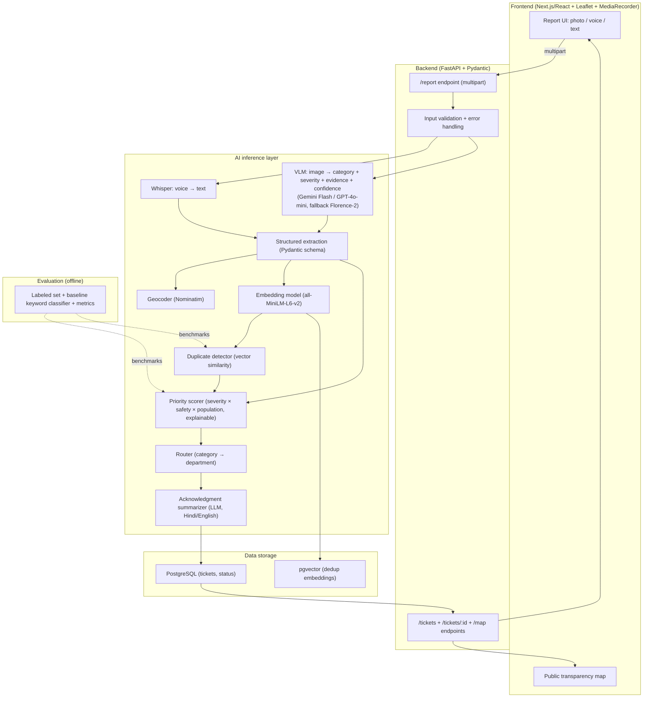

# Shinchan Online Hackathon 2026 — Winning Project Research

> **Prepared for:** a B.Tech AI & Data Science student targeting the **Shinchan Online Hackathon — 24 Hour Hackathon by Devengers**.
> **Hardware baseline (from the supplied documents):** NVIDIA RTX 3050 Laptop GPU (6 GB VRAM), ~16 GB RAM, Windows 11.
> **Research date:** 29 October 2026 (IST).
> **Label key:** `[VERIFIED]` = confirmed from a primary/credible source · `[SOURCE-DERIVED]` = taken from the supplied reference documents · `[RESEARCH FINDING]` = conclusion from my external research · `[INFERENCE]` = reasonable deduction, not directly stated · `[HYPOTHESIS]` = strategic judgment needing validation · `[UNVERIFIED]` = could not be confirmed · `[RECOMMENDATION]` = my strategic advice.

---

## 1. Executive Summary

**The decisive answer:** Build **"Samadhaan" (समाधान)** — a **multimodal civic-grievance triage and transparent-redressal assistant** that lets a citizen report a problem (pothole, garbage, broken streetlight, water leak, unsafe wiring) with **a photo, a voice note, or one line of text in Hindi/English**, and then uses AI to **classify it, score its severity, detect duplicates, route it to the correct department, and explain *why*** — with a public transparency dashboard and a plain-language acknowledgment in the citizen's language.

**Why this project wins this specific event:**

1. **It matches what Devengers judges demonstrably reward.** The most recent Devengers event's standout entry was *CivicFix* — a civic issue reporting/tracking platform — and its author openly admitted the **AI severity feature failed to ship in time**. Samadhaan is the same category *but with the AI actually working, plus multimodal regional-language intake, explainable prioritization, and duplicate detection* — a direct, evidence-backed improvement on the proven winning formula. `[RESEARCH FINDING]`
2. **The AI is load-bearing, not decorative.** Remove the AI and you are left with a static complaint form. The multimodal classification, severity scoring, duplicate detection, routing, and summarization are all genuine AI work — the exact test the supplied documents warn judges now apply. `[SOURCE-DERIVED]`
3. **It is buildable solo in 24 hours with free tools** (Gemini Flash free tier or the OpenAI credits Devengers provides, a local embedding model, and free-tier deployment), with a **high-impact, visual, three-minute live demo**.
4. **It carries a defensible trust/verification layer** (confidence scores, evidence of *why* a complaint is urgent, and a human-in-the-loop flag for low-confidence cases) — importing the strongest engineering concept from the reference documents (self-correcting/verifiable AI) without their "looks like a chatbot" demo weakness.

**Backup project:** **"Satya" (सत्य)** — a self-correcting, citation-grounded assistant for government-scheme eligibility that verifies every AI claim against official sources, flags unsupported statements, and answers in Hindi/English. It reuses Samadhaan's core trust-layer components and is the fallback if the multimodal/API path breaks.

**Three strongest reasons for this selection** (detail in §25): (1) best judging alignment + demo impact, (2) evidence-backed differentiation on a proven category, (3) highest reliability-to-innovation ratio for a 24-hour solo build.

**Largest unresolved risk:** the exact **Shinchan-edition theme, dates, and team rules are `[UNVERIFIED]`** because the Unstop page is a JavaScript app; the participant must confirm them first-hand (see §2.3, §26).

**First implementation action:** register/confirm the event rules, then stand up the repo + FastAPI skeleton + a single working "photo → category + severity" inference call (Phase A–B, §19).

---

## 2. Hackathon Overview and Verified Requirements

### 2.1 Event identity

| Field | Value | Confidence |
|---|---|---|
| **Official name** | Shinchan Online Hackathon — 24 Hour Hackathon | `[VERIFIED from event name]` |
| **Organizer** | Devengers (community-driven coding/platform community) | `[VERIFIED via third-party sources]` |
| **Event link** | https://unstop.com/p/shinchan-online-hackathon-24-hour-hackathon-devengers-1771802 | `[VERIFIED, supplied]` |
| **Duration** | 24 hours | `[VERIFIED from event name]` |
| **Format** | Online | `[VERIFIED from event name]` |
| **Time zone** | IST (Asia/Kolkata) | `[INFERENCE from prior Devengers events]` |

**What "Devengers" is:** a community-driven platform running coding contests, quizzes, college fests, and hackathons (e.g., *HackDevengers 1.0*, *Hack Devengers 2.0*, *Minecraft Devengers*, *DSA War 2026*). These are skill-building competitions with cash prizes + platform credits, **not** government schemes. Sources: [startupfunds.in — HackDevengers 1.0](https://startupfunds.in/funding/hackdevengers-10), [startupfunds.in FAQ](https://startupfunds.in/funding/hackdevengers-10/faq), [Devengers WhatsApp channel](https://www.whatsapp.com/channel/0029VbCVGAd8KMql7Ie3ew43), [LinkedIn — officialdevengers](https://in.linkedin.com/company/officialdevengers).

### 2.2 The Devengers playbook (reconstructed)

The Shinchan Unstop page returned no readable content (JavaScript SPA). The following is reconstructed from two prior Devengers events and participant testimonials — **the most likely rules, not confirmed Shinchan-specific rules.**

**[VERIFIED for HackDevengers 1.0 — 8-hour edition, 9 Aug 2026]** (via [startupfunds.in FAQ](https://startupfunds.in/funding/hackdevengers-10/faq)):

- **Solo entry only** — no teams, no team size.
- **Time-boxed, equal start** — problem statement revealed live at opening, no head start.
- **Tracks:** Generative AI / Artificial Intelligence / Web Development (1.0).
- **Prize:** ~USD 300 / ~₹27,600, cash to top 3; **free Vercel + OpenAI credits for all registered participants**; top-10 certificate; participation certificate for valid submissions.
- **Submission:** Google Form (shared in the mandatory WhatsApp community); a valid entry = **GitHub repo link + live deployment link + project description**.
- **Judging:** manual, on **innovation, technical implementation, code quality, problem-solving approach, functionality, scalability, user experience**.
- **Registration:** via Unstop; joining the WhatsApp community is compulsory.

**[VERIFIED via participant write-up — Hack Devengers 2.0]** (via [LinkedIn — "Building CivicFix in 8 hours at Devengers 2.0"](https://www.linkedin.com/posts/rohan-gawade-38a217313_development-hackathon-civictech-activity-7492443450613735425-VqIT)):

- Described as an **"8-hour open-innovation hackathon"**, **solo** ("8 hours. 1 developer. 1 idea.").
- The participant built **CivicFix** (civic issue reporting/tracking with AI damage & severity detection); the AI was **not fully deployed in time**, and he prioritized a working core instead. Key quote: *"Hackathons aren't just about building. They're about making the right decisions under pressure."*

**[INFERENCE for the Shinchan 24-hour edition]** (likely, but `[UNVERIFIED]`):

1. **Open-innovation or a revealed-theme format**; "Shinchan" is almost certainly a themed/playful edition name (Devengers also runs "Minecraft Devengers", "DSA War 2026").
2. **24 hours** ≈ 3× the 8-hour build time → judges will expect a **more complete, polished product**.
3. **Solo or very small team** — do not assume teammates exist.
4. **Submission still = GitHub + live deployment + description** (strongly implied by the consistent format).
5. **Judging still manual** on a similar dimension list.

### 2.3 Confirmed vs. unconfirmed

| Item | Status |
|---|---|
| Organizer = Devengers; online; 24-hour; IST | `[VERIFIED]` |
| Submission = GitHub + live deployment + description | `[VERIFIED for prior editions; INFERENCE for Shinchan]` |
| Manual judging; dimensions (innovation, implementation, code quality, problem-solving, functionality, scalability, UX) | `[VERIFIED for prior editions; INFERENCE for Shinchan]` |
| Solo vs. team; tracks; theme; exact dates; exact prize | `[UNVERIFIED]` (Unstop SPA) |
| PPT/video/pitch required? | `[UNVERIFIED]` — prior editions needed only repo + link + description |

> **⚠️ Highest-priority participant action:** open the Unstop page in a logged-in browser and the mandatory WhatsApp community, and record the **exact start/end times, theme/track, team rules, prize, and submission fields**. This report is built to be robust to either open-innovation or themed 24-hour formats, but the **deadline and time zone are non-negotiable**.

---

## 3. Rules, Constraints, and Judging Criteria

### 3.1 Effective winning constraints (derived)

1. **One complete, deployed, working product beats ten half-features.** Manual judges skim many entries.
2. **GitHub matters** (code quality + implementation are scored): clean repo, clear README, architecture diagram, honest evaluation.
3. **Live deployment is table stakes** — a dead link is disqualifying.
4. **AI must be load-bearing** — the "would removing the AI make it worse?" test.
5. **Problem clarity + social impact are cheap to win with** (CivicFix evidence).
6. **Reliability > sophistication** — over-investing in one fragile AI feature is the documented losing move.

### 3.2 Provisional scoring model (`[RECOMMENDATION]`, clearly labeled provisional)

Exact Shinchan weights are `[UNVERIFIED]`; the evaluation matrix uses this provisional model mapped to the known Devengers themes + best practice. **Not presented as official criteria.**

| # | Dimension (abbrev.) | Wt | Maps to |
|---|---|---|---|
| 1 | Alignment w/ format & theme (Align) | 8% | problem-solving approach |
| 2 | Problem importance & need (Prob) | 8% | innovation, problem-solving |
| 3 | Innovation & differentiation (Innov) | 8% | innovation |
| 4 | Technical depth (Tech) | 8% | technical implementation |
| 5 | 24-hour feasibility (Feas) | 9% | risk control |
| 6 | Demo impact & clarity (Demo) | 9% | user experience |
| 7 | End-to-end functionality (E2E) | 9% | functionality |
| 8 | Measurable validation (Valid) | 6% | code quality, problem-solving |
| 9 | Real-world usefulness (Real) | 7% | problem-solving, scalability |
| 10 | Reliability & resilience (Reliab) | 6% | technical implementation |
| 11 | Ease of explanation (Explain) | 6% | user experience |
| 12 | Scalability beyond prototype (Scale) | 5% | scalability |
| 13 | Data/API availability (Data) | 5% | risk control |
| 14 | Low implementation-failure risk (LowRisk) | 3% | risk control |
| 15 | Stand-out vs. competitors (Stand) | 3% | innovation |

**Scale (1–10):** 9–10 exceptional · 7–8 strong · 5–6 adequate · 3–4 weak · 1–2 fatal.

---

## 4. Analysis of the Three Reference Documents

### 4.1 What each document is (and how to weight it)

| Document | Nature | Value for *this* 24-hour event |
|---|---|---|
| **`AI_Hackathon_Project_Ideas_Research_2026.md`** (25 ideas) | Practical, student-facing, RTX-3050-tuned, SIH/Devpost/Imagine Cup patterns | **Highest** — most ideas are explicitly 24–48h-scoped; best India-domain thesis |
| **`25_PROBLEM_FIRST_AI_INNOVATION_PROJECTS_2026.md`** (25 dossiers) | Research-grade, problem-first, hard domains (bridges, grids, ICU, climate, supply chain) | **Low for build, high for concepts** — most need µPMUs/Jetson/physical rigs/credentialed data; reusable ideas = physics-informed constraints, uncertainty/calibration, workflow integration |
| **`ADVANCED_AI_HACKATHON_PROJECT_ROADMAP.md`** (15 + VidScholar) | Engineering-depth, production-thinking (RAG eval, LLM gateways, security, observability) | **Medium-high** — best source of differentiating engineering techniques, but several are multi-week builds |

### 4.2 Cross-document overlaps (merged — not counted as independent)

- **Crop-disease CV:** *CropSense Lite* (doc2 P1) ≈ *AgroScope* (doc3 P9) ≈ *AgriSpore-Vision* (doc1 P9).
- **Construction/worksite safety CV:** *SafeSite-Edge* (doc1 P4) ≈ *ConstructSafe AI* (doc3 P3).
- **Self-correcting RAG:** *ContextForge* (doc3 P1) ≈ RAG-quality emphasis across doc2.
- **Code-review agent:** *CodeReview Agent* (doc2 P5) ≈ *CodeReview Agent* (doc3 P4) — identical.
- **Medical document intelligence:** *ScanSafe* (doc2 P9) ≈ *DocuMind* (doc3 P6).
- **LLM security/gateway/eval:** *LLMGuard* (doc2 P15) ≈ *Sentinel* (doc3 P2) ≈ *ThreatScope* (doc3 P14) ≈ *EvalHub* (doc3 P8).
- **Accessibility for the visually impaired:** *AccessLens* (doc3 P12) ≈ *IndicDoc* (doc2 P19) ≈ the Imagine Cup accessibility winners referenced in doc2.
- **Agri advisory agent:** *AgriVoice* (doc2 P8) — adjacent to doc1 agriculture domain.

### 4.3 Strongest reusable technical concepts (24-hour-viability flagged)

| Concept | Source | 24h-viable? |
|---|---|---|
| Self-correcting RAG (retrieval eval → query rewrite → rerank → faithfulness) | Doc3 P1 | Yes — scope to 2–3 stages |
| Structured output (Pydantic/Outlines/Instructor) | Docs 2 & 3 | **Yes — trivial, high-reliability win** |
| Multimodal VLM (Qwen2.5-VL / Florence-2 / Gemini Flash) | Docs 2 & 3 | Yes — API or small local model |
| Small language models (Qwen2.5, Llama-3.2, Phi, Gemma) | Docs 2 & 3 | Yes |
| Multilingual Indic (Whisper ASR, IndicTrans2, Indic NLP) | Doc 2 | Yes — India differentiation |
| Time-series foundation models (Chronos/Moirai/MOMENT) | Doc 2 | Yes — CPU inference |
| Edge CV (YOLO + TensorRT/TFLite) | Docs 1/2/3 | Conditional — camera discipline |
| Physics-informed ML (PINO/PG-GNN/PDE loss) | Doc 1 | **No for 24h** |
| LLM gateway (semantic cache, routing, guardrails) | Doc 3 | Yes — but "infrastructure" demos are weak |
| AI security/guardrails (injection, PII, red-teaming) | Doc 3 | Yes — as a *feature*, not a product |
| Uncertainty/calibration & human-in-the-loop | Doc 1 | **Yes — as a trust layer** |
| Evaluation-driven dev (baseline + metric) | Docs 2 & 3 | **Yes — cheap, judge-winning** |

### 4.4 Critical audit — what NOT to build (per document)

- **Doc 1, infeasible in 24h:** *GridArc-µPMU* (OPAL-RT/RTDS + Jetson + µPMU), *PyroCast-AI* (WRF-SFIRE supercompute), *SepsisWave-AI* (credentialed MIMIC + proprietary monitors), *BarnSentry-AI* (Jetson + LWIR + proprietary data), *HistoTriage-AI* (gigapixel compute), *HydroPulse-GNN* (100m pipe loop), *BridgeGuard-AI* (sensor rig + bespoke calibration). `[SOURCE-DERIVED]`
- **Doc 1, hard data/licenses:** MIMIC-IV/PhysioNet (credentialed), n2c2 Harvard DUA, How2Sign, proprietary bioacoustics. `[SOURCE-DERIVED]`
- **Doc 1, unproven claims to avoid repeating:** "eliminate bridge collapses", "prevent 75% of wildfires", BLEU-4 ≥24 for sign language (SOTA is ~8–12). `[SOURCE-DERIVED]`
- **Doc 2, too ambitious for 24h:** *FloodSense* (SAR + Chronos + Airflow), *PrivacyLens* (FL + ResNet + DP), *UrbanPulse* (YOLO + Kafka + BERT + Mapbox), *HealthAI Observatory*, *PredictaHealth*, *ThinkTrace*, *AdaptLearn*. `[SOURCE-DERIVED]`
- **Doc 2, generic/crowded:** *SmartAQI*, *EduPath*, *SafeCommute*, *ResumeAlign*, *CricketIQ*. `[SOURCE-DERIVED]`
- **Doc 3, too ambitious for 24h:** *MemoAgent*, *FlowForge*, *HealthSig*, full *VidScholar*, full *ContextForge* self-correction. `[SOURCE-DERIVED]`
- **Doc 3, weak demo:** *EdgeInfer* (4/10), *EvalHub* (5/10), *FlowForge* (6/10). `[SOURCE-DERIVED]`

### 4.5 The one meta-lesson that shapes the final choice

Across all three documents, the consistent winning formula is: **a specific user + a concrete problem + one complete journey + AI that does something a script cannot + a visible result + a baseline/metric.** The reference documents' top picks (*AgriVoice*, *IndicDoc*, *LLMGuard*, *ContextForge*, *ConstructSafe*, *DocuMind*) all satisfy parts of this, but several fail the **demo-clarity** or **reliability** test for a *manual*, *high-volume*, *non-specialist* judging process. The final selection (§12) optimizes across all of them.

---

## 5. Consolidated Project Inventory

*(Full per-project fields for all 25+25+15 source projects are preserved in the traceability appendix §28. This section presents the merged, distinct catalog that feeds the evaluation. "24h?" = my feasibility judgment for a solo 24-hour build: ✅ viable · ⚠️ partial/scoped · ❌ infeasible.)*

| # | Merged concept | Source(s) | 24h? |
|---|---|---|---|
| C1 | Crop-disease diagnosis (CV + advisory) | doc2 P1, doc3 P9, doc1 P9 | ✅ (pretrained) |
| C2 | Construction/worksite safety CV | doc1 P4, doc3 P3 | ✅ |
| C3 | Self-correcting RAG research engine | doc3 P1 | ⚠️ (basic RAG ✅) |
| C4 | Code-review agent | doc2 P5, doc3 P4 | ⚠️ |
| C5 | Medical document intelligence | doc2 P9, doc3 P6 | ✅ |
| C6 | Accessibility reader (visual impairment) | doc3 P12, doc2 P19 | ⚠️ (English TTS ✅) |
| C7 | Agri advisory agent (live data + Indic) | doc2 P8 | ⚠️ (English + 2 tools ✅) |
| C8 | LLM gateway / security / eval | doc3 P2/P8/P14, doc2 P15 | ⚠️ (subset ✅) |
| C9 | Gov-scheme eligibility navigator | doc2 P10 | ✅ |
| C10 | Voice medical-history collector | doc2 P2 | ✅ |
| C11 | Women's-safety reporting + hotspots | doc2 P7 | ✅ |
| C12 | Construction cost estimator | doc2 P14 | ⚠️ |
| C13 | NL→SQL analytics | doc3 P10 | ⚠️ |
| C14 | Time-series forecasting (AQI/flood) | doc2 P3/P16 | ⚠️ |
| C15 | Fitness/pose analysis | doc3 P7 | ✅ |
| C16 | Software CVE-reachability (ReachGuard) | doc1 P20 | ⚠️ |
| C17 | Accessible PDF/UA remediation | doc1 P24 | ⚠️ |
| C18 | Systematic-review screening | doc1 P22 | ⚠️ |
| C19 | Cold-chain shelf-life | doc1 P10 | ⚠️ |
| C20 | Misinformation / fact-checking | doc2 P12 | ❌ (credibility risk) |
| C21 | ICU early warning | doc1 P5, doc2 P13 | ❌ (credentialed data) |
| C22 | Federated learning (healthcare) | doc2 P21 | ❌ |
| C23 | Adaptive testing (IRT/CAT) | doc2 P6/P24 | ⚠️ |

---

## 6. Existing Products and Competitive Landscape

### 6.1 What wins at Devengers events (evidence) `[RESEARCH FINDING]`

- **CivicFix** (Devengers 2.0): civic issue reporting/tracking + AI damage/severity detection; the AI was incomplete at deadline. → civic-tech + social impact + a working web app is squarely in the winning zone.
- **VoteWise** (same author, other events): civic-education RAG assistant with guardrails + persona modes.
- **Attendease**: smart attendance. Pattern: **practical civic/education problems, Gemini/LLM + React + FastAPI, deployed on Vercel/Render.**

**Takeaway:** Devengers judges reward **clear civic/social problems with a working web app and a visible AI feature** — not exotic research. A familiar category wins when executed and demonstrated well.

### 6.2 Oversaturated categories (avoid unless sharply differentiated)

| Category | Why saturated | How to still win |
|---|---|---|
| Generic chatbot / "ChatGPT wrapper" | Trivial; judges detect it | Specific user + domain + data + a non-LLM AI contribution |
| Generic "chat with PDF" RAG | Table stakes | Add self-correction/eval/citations/multilingual |
| Resume analyzer / ATS scorer | Overdone, low impact | Only a genuinely unserved niche + measurable output |
| Study assistant / flashcard gen | Commodity | Real diagnostic engine (IRT/skill map), not rephrasing |
| Symptom checker / health chatbot | Liability + regulatory | Narrow, well-scoped screening + disclaimers |
| Stock/crypto predictor | Low credibility | Avoid |
| AI content/video generator | Commodity, wrapper-prone | Real pipeline + quality gates |

### 6.3 Open gaps (synthesized, with the strongest evidence)

1. **Indic/regional-language access** — most tools are English/Hindi-only; first-class regional support is under-exploited (doc2's core thesis). `[SOURCE-DERIVED]`
2. **Trust & verification of LLM output** — self-correcting RAG, citation grounding, faithfulness checks are *discussed* but *rarely built well* by students (doc3). `[SOURCE-DERIVED]`
3. **Actionable decision-support, not chat** — judges reward a specific recommendation/decision backed by data (docs 1 & 2). `[SOURCE-DERIVED]`
4. **Civic/public-service digitization** — Devengers' own winners demonstrate appetite for civic-tech with AI prioritization. `[RESEARCH FINDING]`
5. **Measurable evaluation story** — most entries have none; a baseline + metric is a cheap, reliable differentiator (docs 2 & 3). `[SOURCE-DERIVED]`

### 6.4 Explicit humility note

No claim of global uniqueness is made here. Language used below is "differentiated approach / identified gap / potential novelty" unless uniqueness is convincingly established. A quick search failing to find an identical product is **not** proof of novelty. `[RESEARCH FINDING]`

---

## 7. New Opportunities Identified Through Research

1. **Multimodal civic-grievance intake in regional languages** — gap: existing civic apps (incl. CivicFix) are largely text/English; low-literacy citizens excluded. `[RESEARCH FINDING]`
2. **Explainable severity/priority scoring for civic issues** — gap: CivicFix's AI "prioritization" didn't ship; no incumbent shows *why* something is urgent. `[RESEARCH FINDING]`
3. **Duplicate-detection to reduce complaint noise** — gap: same pothole → dozens of tickets; embedding-based dedup is a real, unmet, AI-native feature. `[RESEARCH FINDING]`
4. **Verifiable AI answers (anti-hallucination with citations)** — gap: RAG is common but almost never self-correcting/evaluated (doc3). `[SOURCE-DERIVED]`
5. **Document-to-decision for Indian workflows** (bills, prescriptions, notices, land records) — gap: extraction exists, but *decision* (overcharge? interaction? deadline?) is missing (docs 2 & 3). `[SOURCE-DERIVED]`
6. **Actionable agri advisory with live data** — gap: no open tool integrates mandi price + weather + soil + Indic conversation (doc2). `[SOURCE-DERIVED]`
7. **LLM reliability/guardrails as a visible trust layer** — gap: OWASP LLM concerns, but students rarely demonstrate defenses (doc3). `[SOURCE-DERIVED]`

---

## 8. Candidate Project Ideas (16 candidates, three strategies)

> Each candidate: **User · Problem · Solution · Demo.** Full detail for the top five is in §10.

### Strategy A — adapted from the reference documents (6)

1. **MandiSaarthi** *(AgriVoice-lite)* — Farmer · "should I sell now?" without data · agent with live mandi price + weather + crop advisory (English→Hindi). Demo: ask in Hindi, get cited recommendation. `[doc2 P8]`
2. **IndicDoc-lite** *(IndicDoc/AccessLens)* — Blind/low-vision user · can't read govt documents · upload → structured extraction + English/Hindi TTS readout. Demo: upload a form, hear it read aloud. `[doc2 P19, doc3 P12]`
3. **ConstructSafe-lite** *(ConstructSafe/SafeSite)* — Safety officer · PPE violations missed · webcam YOLO detection + live alert + compliance chart. Demo: put on/remove a hardhat live. `[doc3 P3, doc1 P4]`
4. **ContextForge-lite** *(ContextForge)* — Researcher · RAG hallucinates silently · self-correcting RAG with citations + faithfulness flag. Demo: upload PDF, ask, watch a claim get flagged. `[doc3 P1]`
5. **DocuMind-lite** *(DocuMind/ScanSafe)* — Patient/admin · scattered documents · upload → structured JSON + plain summary. Demo: upload a lab report → extracted values. `[doc3 P6, doc2 P9]`
6. **GovSeek-lite** *(GovSeek)* — Citizen · doesn't know eligible schemes · profile → eligible schemes + how-to in Hindi. Demo: profile → top-5 schemes. `[doc2 P10]`

### Strategy B — intelligent combinations (5)

7. **Samadhaan** — *Civic-grievance triage* = CivicFix (report/track) + UrbanPulse/SafeCommute (multimodal + clustering) + doc3 trust layer (explainable confidence) + doc2 Indic. Citizen reports via photo/voice/text → AI classifies + severity + dedup + routes + explains → transparent dashboard + regional acknowledgment. `[RESEARCH FINDING + doc2 P7/P22, doc3 trust layer]`
8. **Satya** — *Self-correcting scheme/legal verifier* = ContextForge + GovSeek + doc3 faithfulness. User asks eligibility → answer with inline citations + faithfulness check + confidence + Hindi. `[doc3 P1, doc2 P10]`
9. **MediBaat** — *Voice medical-history collector* = VoiceDoc + DocuMind structured extraction + Indic. ASHA worker speaks → structured JSON → plain summary. `[doc2 P2/P9]`
10. **SafeRoute** — *Women's-safety assistant* = SafeCommute + routing. Anonymous incident report + hotspot clustering + safer-route suggestion. `[doc2 P7]`
11. **BuildEst** — *Construction cost estimator* = BuildMind + DocuMind. Floor-plan/text → BoQ → regional price estimate → PDF. `[doc2 P14, doc3 P6]`

### Strategy C — original ideas beyond the documents (5)

12. **BillGuard** — *Bill/statement error & overcharge detector*: upload a utility/telecom/bank statement → AI extracts line items, flags anomalies/overcharges vs. a rules + LLM check → plain explanation + a ready-to-send dispute letter in Hindi/English. **Original.**
13. **RationRight** — *PDS/entitlement voice assistant*: a low-literacy citizen asks "am I getting my ration?" in voice → AI explains entitlement, checks the family's card details, flags missing benefits, generates a grievance. **Original.**
14. **MedSave** — *Prescription affordability advisor*: photo of a prescription → AI extracts medicines, finds cheaper generic equivalents + interactions, and shows cost savings with a pharmacy-note. **Original.**
15. **FormSaarthi** — *Voice-first government form-filler*: a citizen answers spoken questions → AI fills the form fields + produces a document checklist + plain next steps. **Original.**
16. **KhetiRaksha** — *Crop-insurance claim assistant*: photo of a damaged field → AI estimates damage/severity → generates a claim checklist + plain guidance for PMFBY. **Original.**

---

## 9. Comparative Evaluation Matrix

Scores 1–10 per §3.2; **Weighted** = Σ(score×weight)/100 (scale 0–10). "MVP" = qualitative probability of a complete solo MVP in 24h.

| # | Candidate | Align | Prob | Innov | Tech | Feas | Demo | E2E | Valid | Real | Reliab | Explain | Scale | Data | LowRisk | Stand | **Wtd** | MVP | Verdict |
|---|---|---|---|---|---|---|---|---|---|---|---|---|---|---|---|---|---|---|---|
| 7 | **Samadhaan** | 9 | 9 | 8 | 8 | 8 | 10 | 9 | 7 | 9 | 7 | 9 | 9 | 9 | 8 | 8 | **8.54** | High | **PRIMARY** |
| 8 | **Satya** | 8 | 8 | 9 | 9 | 7 | 7 | 8 | 10 | 8 | 7 | 7 | 8 | 9 | 7 | 9 | **8.03** | Med-High | **BACKUP** |
| 12 | **BillGuard** | 8 | 8 | 8 | 8 | 8 | 8 | 8 | 7 | 8 | 7 | 8 | 7 | 8 | 7 | 8 | **7.80** | Med-High | Top-5 |
| 4 | **ContextForge-lite** | 7 | 8 | 9 | 9 | 7 | 6 | 8 | 10 | 8 | 7 | 6 | 8 | 9 | 7 | 8 | **7.77** | Med | Top-5 |
| 5 | **DocuMind-lite** | 8 | 8 | 6 | 7 | 7 | 9 | 8 | 7 | 9 | 7 | 8 | 8 | 8 | 7 | 6 | **7.62** | Med-High | Top-5 |
| 3 | ConstructSafe-lite | 8 | 8 | 6 | 8 | 7 | 10 | 8 | 7 | 9 | 6 | 7 | 7 | 8 | 6 | 6 | 7.59 | Med-High | — |
| 2 | IndicDoc-lite | 9 | 9 | 8 | 8 | 5 | 9 | 7 | 6 | 9 | 5 | 8 | 7 | 8 | 5 | 9 | 7.55 | Low-Med | — |
| 1 | MandiSaarthi | 9 | 9 | 8 | 8 | 6 | 8 | 7 | 7 | 9 | 5 | 8 | 8 | 6 | 5 | 7 | 7.50 | Med | — |
| 14 | MedSave | 8 | 8 | 7 | 7 | 8 | 7 | 8 | 7 | 8 | 7 | 8 | 7 | 7 | 7 | 7 | 7.47 | Med-High | — |
| 6 | GovSeek-lite | 9 | 9 | 6 | 7 | 7 | 8 | 8 | 6 | 9 | 7 | 8 | 7 | 6 | 6 | 6 | 7.45 | Med | — |
| 10 | SafeRoute | 8 | 9 | 6 | 6 | 8 | 8 | 8 | 6 | 9 | 7 | 7 | 7 | 7 | 7 | 6 | 7.40 | Med-High | — |
| 9 | MediBaat | 8 | 8 | 6 | 7 | 8 | 7 | 8 | 7 | 8 | 7 | 8 | 7 | 7 | 7 | 6 | 7.36 | Med-High | — |
| 13 | RationRight | 9 | 8 | 6 | 6 | 8 | 7 | 8 | 6 | 8 | 7 | 8 | 7 | 6 | 7 | 6 | 7.25 | Med | — |
| 15 | FormSaarthi | 8 | 8 | 6 | 6 | 8 | 7 | 8 | 6 | 8 | 7 | 8 | 7 | 7 | 7 | 6 | 7.22 | Med | — |
| 16 | KhetiRaksha | 9 | 8 | 7 | 7 | 6 | 8 | 7 | 6 | 9 | 6 | 8 | 7 | 6 | 5 | 7 | 7.21 | Low-Med | — |
| 11 | BuildEst | 7 | 7 | 7 | 7 | 6 | 7 | 7 | 6 | 7 | 6 | 7 | 7 | 5 | 5 | 6 | 6.60 | Low-Med | — |

**Reading the table:**
- **Samadhaan** wins on the combination the event rewards most: Demo (10), Alignment (9), Problem (9), Real-world (9), Explainability (9), Scale (9) — with acceptable innovation (8) and reliability (7) that are explicitly managed (§20).
- **Satya** is the innovation/validation leader (Innov 9, Valid 10) but is dragged down by Demo (7) and Explainability (7) — the classic "brilliant but invisible" risk.
- **BillGuard** is the strongest *original* idea: balanced, visual, novel — a legitimate dark-horse and the reason it lands in the top five.
- **ContextForge-lite / DocuMind-lite** are strong but each has a specific structural weakness (demo clarity for the former; differentiation for the latter).
- Scores are **comparative strategic judgments, not measured probabilities**; "MVP" is a reasoned qualitative estimate, not a computed odds.

---

## 10. Top Five Project Dossiers

### Dossier 1 — Samadhaan (PRIMARY)

**A. Identity**
- **Pitch:** "Report a civic problem with a photo, a voice note, or a line of text in your own language — Samadhaan classifies it, scores its urgency, routes it to the right department, and shows you *why*, publicly and transparently."
- **Problem:** Citizens can't easily report civic issues (potholes, garbage, broken streetlights, water leaks, unsafe wiring); authorities drown in duplicate, unstructured, mis-routed complaints; no one knows why one issue is prioritized over another.
- **User:** Citizens (incl. low-literacy, non-English speakers); municipal authorities.
- **Use case:** A resident photographs a pothole near a school → AI returns "pothole, severe, near a school, high priority" with the evidence → routes it to the roads department → Hindi acknowledgment with an expected timeline → appears on a public map.
- **Why now:** Urban India's grievance systems are text/English-centric; multimodal + regional-language + explainable prioritization is a gap no incumbent closes. `[RESEARCH FINDING]`

**B. Differentiation**
- **Existing:** CivicFix (text-first, AI incomplete), municipal portals (static forms), Swachhata/Swachh apps (single-domain), generic "AI complaint" tools (black-box priority).
- **Limitations:** text/English-only; no explainable severity; duplicate tickets; no regional-language acknowledgment; opaque prioritization.
- **Innovation:** multimodal intake (photo+voice+text) · explainable severity/priority with confidence · embedding-based duplicate detection · department routing · regional-language acknowledgment · public transparency dashboard · **human-in-the-loop flag for low-confidence cases** (the trust layer).
- **Unique demo capability:** the "why is this urgent?" panel + the live duplicate-detection moment + the Hindi voice-to-ticket flow.
- **Hard-to-replicate in 24h:** a *working* end-to-end multimodal pipeline with explainability + dedup — competitors typically ship either a static form or a single "chatbot + form" and skip the trust layer.

**C. AI contribution**
- **Models:** VLM for image→{category, severity, objects} (Gemini Flash / GPT-4o-mini; local Florence-2 fallback); Whisper for voice→text; sentence-transformer (`all-MiniLM-L6-v2` / `bge-small`) for duplicate embeddings; LLM for acknowledgment summarization + Hindi output; Pydantic structured output.
- **Pipeline:** input (image/audio/text) → ASR/OCR if needed → structured classification (category, severity 1–5, objects/evidence, confidence) → location extraction (geotag or address→Nominatim) → dedup (vector similarity vs. open tickets) → priority score (severity × safety-class × affected-population, with weights shown) → routing (category→department map) → acknowledgment (LLM, Indic) → dashboard update.
- **Output:** a ticket with category, severity, priority score breakdown, evidence, confidence, route, and a plain-language acknowledgment.
- **Decision enabled:** what to fix first and who should fix it — the core civic-operations decision.
- **Metric:** category accuracy, severity accuracy, dedup precision/recall, routing accuracy, end-to-end latency.
- **Failure cases:** misclassified object (e.g., shadow = pothole); wrong severity (weather-dependent); false duplicate (two genuinely different potholes); geocoding failure (rural/unnamed roads).
- **If AI removed:** a static form with no classification, no prioritization, no dedup, no routing — i.e., the problem it claims to solve disappears.

**D. Feasibility**
- **Stack:** Python/FastAPI + Pydantic; Next.js/React + Tailwind + Leaflet (map) + MediaRecorder (voice).
- **Models/APIs:** Gemini Flash (free tier) or OpenAI (Devengers credits); faster-whisper (local); `sentence-transformers` all-MiniLM-L6-v2 (CPU); Nominatim (free geocoding).
- **DB:** PostgreSQL + pgvector (or SQLite + ChromaDB fallback).
- **Data:** ~40 hand-labeled complaint examples (images + text) for eval; demo images from Pexels/Roboflow public sets.
- **Deploy:** Vercel (frontend) + Render/Railway (backend).
- **Effort:** ~18–20 focused hours (solo). **Most dangerous dependency:** the VLM API key/quota during the live demo → mitigated by pre-caching outputs + a local Florence-2 fallback + recorded-fallback (§20, §21).

**E. Three-minute demo:** see §21.

**F. Adversarial review:** see §11.

---

### Dossier 2 — Satya (BACKUP)

- **Pitch:** "Government schemes explained with receipts — every answer cited to the official source, every unverified claim flagged."
- **Problem/User:** Citizens (and last-mile workers) get wrong/outdated/hallucinated eligibility information; they need *verifiable* answers.
- **Solution:** RAG over a curated corpus of official scheme documents → answer with inline citations → faithfulness check → confidence score → Hindi/English.
- **AI:** hybrid retrieval (BM25 + semantic), LLM generation with citation instructions, a faithfulness/verification pass (NLI model or LLM-as-judge), structured output.
- **Differentiation:** the **trust layer** (self-correction + citation + "unsupported claim" flag) — the #1 under-built capability in student RAG (`[SOURCE-DERIVED]`).
- **Demo:** ask an eligibility question → show naive RAG hallucinating → show Satya flagging the unsupported claim and citing the correct source.
- **Weakness:** text-centric demo; lower visual drama.
- **Reuse from Samadhaan:** embeddings, structured output, Indic output, confidence display.

### Dossier 3 — BillGuard

- **Pitch:** "Found ₹1,240 in overcharges on your electricity bill — here's the proof and your ready-to-send dispute letter."
- **Problem/User:** Indian consumers can't parse complex utility/telecom/bank statements; overcharges and errors go unchallenged.
- **Solution:** upload a statement → AI extracts line items → rules + LLM anomaly check flags overcharges/errors → plain explanation + dispute letter (Hindi/English).
- **AI:** document parsing (VLM/OCR), structured extraction, anomaly detection (rules + LLM reasoning), generation.
- **Differentiation:** decision (find the error) + action (dispute letter), not just extraction. **Original.**
- **Demo:** a doctored bill with a planted error → AI finds it → shows the amount, reason, and letter.
- **Weakness:** bill-format variability; data-accuracy risk (must not falsely accuse a utility).

### Dossier 4 — ContextForge-lite

- **Pitch:** "RAG that admits when it doesn't know — self-correcting retrieval with citations and a faithfulness score."
- **Solution:** basic RAG + relevance-eval → query-rewrite (capped) → cross-encoder rerank → citation-constrained generation → faithfulness check → confidence.
- **AI:** hybrid search, reranker (`bge-reranker-base`), LLM generation, faithfulness verifier.
- **Differentiation:** measurable retrieval quality (Recall@K, faithfulness) — strong eval story.
- **Demo:** upload a PDF, ask, watch a bad retrieval trigger a rewrite; a claim get flagged.
- **Weakness:** looks like a chatbot unless metrics are surfaced prominently.

### Dossier 5 — DocuMind-lite

- **Pitch:** "Upload any messy document → clean structured data + a plain-language summary, in seconds."
- **Solution:** VLM document understanding → type classification → key-field extraction (JSON) → plain summary.
- **AI:** Florence-2 (local) or Qwen2.5-VL / Gemini; structured output.
- **Differentiation:** layout/structural comprehension + instant visual payoff.
- **Demo:** upload a lab report/prescription → highlighted fields + summary.
- **Weakness:** differentiation is modest (many doc-AI tools); VLM latency on 6 GB.

---

## 11. Adversarial Judge Review (top five)

| Hard question | Samadhaan | Satya | BillGuard | ContextForge-lite | DocuMind-lite |
|---|---|---|---|---|---|
| Genuinely innovative? | Differentiated execution of a proven category (multimodal + explainable + dedup + trust), not a clone | Yes — self-correcting RAG is under-built | Yes — decision+action, original | Partly — discussed but rarely built well | No — well-trodden; needs a sharp angle |
| Real problem? | Yes (civic grievance + authority noise) | Yes (hallucinated scheme info) | Yes (bill errors) | Yes (silent RAG failure) | Yes (paperwork) |
| Is AI necessary? | **Yes** — remove it → static form | Yes — remove → search box | Yes — remove → spreadsheet | Yes — remove → Ctrl+F | Partly — extraction could be rules |
| Mostly an API wrapper? | No — multimodal + dedup + scoring + routing are engineered | No — retrieval + verification + eval | No — anomaly rules + reasoning | No — retrieval + rerank + verification | Borderline — thin wrapper risk |
| Novelty defensible? | Defensible as combination | Defensible | Defensible | Defensible | Weak |
| Demo reliable? | **High** (with fallbacks) | Medium (text) | Medium-High | Medium | High |
| What if model is wrong? | Low-confidence flag → human review | Flag unsupported claims | **Risk:** false accusation → show evidence + "not a final ruling" disclaimer | Flag low confidence | Show raw extraction for review |
| How is it evaluated? | Labeled set vs. keyword baseline | Recall@K, faithfulness vs. naive RAG | Planted-error detection rate vs. rules-only | Recall@K, faithfulness | Field-level accuracy |
| Obvious competitor? | CivicFix (AI incomplete), portals | MyScheme, chatbots | None direct (this is the gap) | Perplexity, NotebookLM | Many doc-AI tools |
| Weakest assumption? | VLM severity reliable on varied photos | Faithfulness checker itself imperfect | Bill parsing generalizes | Reranker/eval latency | VLM handles messy scans |
| What causes failure at judging? | API outage → have fallback; over-claiming accuracy → don't | Demo reads as "just a chatbot" → surface metrics | Wrong flag → always show proof + disclaimer | Metrics overwhelm → lead with one number | "Same as X tool" → need the sharp angle |

**Re-rank after adversarial review:** Samadhaan (1) > Satya (2) > BillGuard (3) > DocuMind-lite (4) > ContextForge-lite (5).
*ContextForge-lite and DocuMind-lite swap because DocuMind's demo is more reliable/visual, while ContextForge's core risk (reads as a chatbot) is only partially mitigated by surfacing metrics.*

---

## 12. Final Project Selection and Backup

**PRIMARY — Samadhaan (समाधान).** **BACKUP — Satya (सत्य).**

**Selection rationale (grounded in the 10 required factors):**
1. **Requirements:** satisfies the Devengers submission (repo + live link + description) and judging dimensions (functionality, UX, innovation, scalability, problem-solving). `[VERIFIED-pattern]`
2. **Real problem:** civic-grievance + authority-noise burden, evidenced by CivicFix's existence and India's municipal context. `[RESEARCH FINDING]`
3. **Differentiation:** multimodal + explainable + dedup + regional-language + trust layer vs. text-only incumbents.
4. **24h feasibility:** high (free APIs + local models + free-tier deploy).
5. **Compelling demo:** photo → classification → priority → map → Hindi ack (visual + emotional).
6. **Measurable performance:** labeled set + keyword baseline + dedup metrics.
7. **Reliability:** API fallback + local fallback + pre-cached outputs + recorded fallback.
8. **Reference documents:** synthesizes doc2 (Indic, civic), doc3 (trust/self-correction), doc1 (workflow integration, human-in-the-loop, explainability). `[SOURCE-DERIVED]`
9. **Hardware:** runs on RTX 3050 (local models) with free API tiers; no GPU training required.
10. **Competitor difficulty:** most solo competitors ship a static form or a chatbot; a *working* multimodal + explainable + dedup pipeline is materially harder to replicate in 24h.

**Why not the runner-up as primary:** Satya is more "innovative" but its demo is text-centric and less emotionally immediate for manual, high-volume judging. BillGuard is excellent but riskier (bill-format variability + false-accusation liability). Samadhaan maximizes the demo × fit × reliability product — the exact selection rule in the brief.

**Component retention (from the combination):** keep multimodal intake + explainable priority + dedup + routing + transparency + trust layer. **Exclude:** real government API integration, auth/login, predictive repair scheduling, mobile app, multi-department federation.

---

## 13. Problem Statement and Product Differentiation

### 13.1 Problem statement

*"A resident of an Indian city who finds a pothole, overflowing garbage, a broken streetlight, or an unsafe wire has no easy way to report it in their own language and no visibility into whether it will be fixed. Municipal authorities receive a flood of unstructured, duplicate, mis-routed complaints and cannot explain or justify their prioritization. Both sides lose — and the problem compounds daily."*

### 13.2 Product differentiation

| Existing alternative | Limitation | Samadhaan's answer |
|---|---|---|
| CivicFix (Devengers 2.0) | Text-first; AI severity never shipped | Working multimodal AI + explainable severity |
| Municipal portals / 311-style forms | Static, English, no prioritization | Photo/voice/text + regional language + priority score |
| Single-domain apps (Swachhata, etc.) | One category only | Multi-category routing |
| Generic "AI complaint" tools | Black-box priority | Explainable score + evidence + confidence |
| Any static form | No dedup → duplicate noise | Embedding-based duplicate detection |

**The defensible claim:** not "we invented civic reporting," but "we built the first *working, explainable, multilingual, multimodal* civic triage layer — with a trust mechanism — where the incumbent's AI did not ship." `[RESEARCH FINDING]`

---

## 14. Complete MVP Specification

- **Name:** Samadhaan (समाधान)
- **Pitch:** *Report a civic problem in your own words — photo, voice, or text — and get a transparent, accountable resolution.*
- **Problem statement:** §13.1.
- **Target users:** citizens (primary, incl. non-English/low-literacy); municipal authorities (secondary).
- **Primary user journey:** Open app → tap "report" → attach photo / record voice / type → AI returns category + severity + priority (with reasons) → confirm location → submit → receive acknowledgment in chosen language → track status on public map.
- **Three essential features:**
  1. Multimodal intake → AI classification (category + severity + confidence) + location extraction + routing.
  2. Duplicate detection + explainable priority scoring.
  3. Transparency dashboard (map + queue + status) + regional-language acknowledgment.
- **Explicitly excluded (24h):** auth/login, real government API integration, predictive repair scheduling, mobile app, cross-jurisdiction federation, video input, analytics admin panel.
- **Expected output:** a structured ticket (category, severity, priority score + breakdown, evidence, confidence, route, status) + a public map + an acknowledgment.
- **Measurable success criteria:** category accuracy ≥ 85% on the labeled set (vs. ~55–65% keyword baseline); severity accuracy ≥ 75%; dedup precision ≥ 85% at ≥ 80% recall; end-to-end ≤ 4s; 1 complete user journey working live.
- **Main differentiator:** explainable, multilingual, multimodal triage with a trust layer — not a form, not a chatbot.

---

## 15. System Architecture and Data Flow



**Data flow (one report):** input → (voice→ASR / image→VLM) → structured classification → location → duplicate check → priority score → route → acknowledgment → persist → publish to map.

**Deliberate simplifications:** monolith (FastAPI + one frontend), no microservices, no message queue, SQLite allowed as DB fallback, no auth. Only one AI-heavy path per input type.

---

## 16. Technology Stack and Model Selection

| Component | Choice | Why | Alternative considered | Free? | Credentials? | GPU? | Fallback |
|---|---|---|---|---|---|---|---|
| Backend | FastAPI + Pydantic | Async, schema-validated, fast to build | Flask/Express | Yes | No | No | — |
| Frontend | Next.js/React + Tailwind + Leaflet | Fast UI, map, deployable to Vercel | Streamlit (faster but less polished) | Yes | No | No | Streamlit if time runs short |
| Image understanding | Gemini Flash (or OpenAI vision) | Free tier / Devengers OpenAI credits, strong VLM | Qwen2.5-VL-7B local (slow on 6 GB) | Free tier | API key | No | **Florence-2 local** (CPU) |
| Voice→text | faster-whisper (small/medium) | Local, free, Hindi-capable | Whisper API (paid) | Yes | No | Optional | Pre-recorded demo audio |
| Embeddings/dedup | `all-MiniLM-L6-v2` (sentence-transformers) | CPU, 384-dim, fast | `bge-small-en-v1.5` | Yes | No | No | cosine sim on TF-IDF |
| Text generation | Gemini Flash / local Qwen2.5-7B (Ollama) | Acknowledgment + Hindi | GPT-4o-mini | Free/credits | API key or local | Optional | Templated acknowledgment |
| Geocoding | Nominatim (OSM) | Free, no key | Google Geocoding (paid) | Yes | No | No | Use user GPS/geotag |
| DB | PostgreSQL + pgvector | Tickets + vector dedup | SQLite + ChromaDB | Yes | No | No | SQLite + in-memory vectors |
| Deployment | Vercel (FE) + Render/Railway (BE) | Free tiers, quick | Fly.io / Hugging Face Spaces | Free tier | Yes | No | Local `uvicorn` + ngrok |

**Budget:** ₹0 target. Every component has a free tier; the Devengers OpenAI credits are the safety net for the VLM/LLM path. `[VERIFIED — credits provided]`

---

## 17. Data Sources, Licensing, and Evaluation

### 17.1 Data
- **Demo/eval images:** Pexels/Unsplash (permissive) and Roboflow public construction/road datasets for potholes/streetlight/garbage. **No proprietary data needed.**
- **Labeled eval set:** hand-label ~40 examples (10 per category × 4 categories) with {category, severity}. This is the single most valuable non-code artifact — it enables the baseline-vs-AI comparison judges ask for.
- **No model training.** Use pretrained models only. Fine-tuning is explicitly avoided (`[RECOMMENDATION]`).
- **Licensing:** all selected models are open (Florence-2, Whisper, all-MiniLM) or free-tier APIs; dataset images are CC0/permissive. Document each license in the README.

### 17.2 Evaluation (the story judges need)

| Metric | Definition | Baseline | Target |
|---|---|---|---|
| Category accuracy | correct department/category on labeled set | keyword classifier (~55–65%) | ≥ 85% |
| Severity accuracy | ±1 of human label (1–5) | majority class | ≥ 75% |
| Dedup precision/recall | on ~10 near-duplicate pairs + 5 hard-negatives | random | P ≥ 85%, R ≥ 80% |
| Routing accuracy | correct department map | none (fixed) | ≥ 90% |
| End-to-end latency | input → ticket | n/a | ≤ 4s |

- **Baseline system:** a deterministic keyword/rule classifier + no dedup — showing the *delta* the AI adds.
- **Expected limitations:** VLM severity is heuristic (not a civil-engineering assessment); geocoding weak on unnamed rural roads; dedup threshold is a trade-off. State these honestly in the README and demo.

---

## 18. Repository Structure and API Design

```text
samadhaan/
├── backend/
│   ├── app/
│   │   ├── main.py            # FastAPI app + routes
│   │   ├── schemas.py         # Pydantic request/response models
│   │   ├── ai/
│   │   │   ├── classify.py    # VLM/Florence classification
│   │   │   ├── asr.py         # Whisper wrapper
│   │   │   ├── embed.py       # embedding + dedup
│   │   │   ├── score.py       # explainable priority scorer
│   │   │   ├── route.py       # category→department map
│   │   │   └── summarize.py   # acknowledgment (Indic)
│   │   ├── geo.py             # Nominatim geocoding
│   │   └── db.py              # DB access
│   ├── requirements.txt
│   └── .env.example
├── frontend/
│   ├── pages/                 # report page, map page
│   ├── components/            # uploader, voice recorder, priority card
│   └── ...
├── data/
│   ├── eval_set.json          # labeled examples
│   ├── baseline.py            # keyword classifier baseline
│   └── run_eval.py            # metrics
├── tests/                     # unit tests for schemas/scorer/router
├── docs/
│   ├── architecture.md
│   └── evaluation_report.md
├── .gitignore
├── README.md                  # problem, demo GIF, architecture, eval, licenses
└── LICENSE
```

### 18.1 API design

**POST `/report`** — multipart (image OR audio OR text + optional lat/lng + language).

Request (multipart):
```json
{ "text": "school ke paas bada gadda hai", "language": "hi",
  "image": "<file>", "lat": 19.07, "lng": 72.87 }
```

Response (JSON, 201):
```json
{
  "ticket_id": "SAM-2026-0042",
  "category": "road_pothole",
  "severity": 4,
  "priority_score": 82,
  "priority_breakdown": { "severity": 40, "safety": 30, "population": 12 },
  "evidence": ["pothole", "near school"],
  "confidence": 0.91,
  "duplicate": { "is_duplicate": false, "similar_ticket": null },
  "route": "Roads & Maintenance Dept.",
  "acknowledgment": "आपकी शिकायत दर्ज कर ली गई है… (expected 7 days)",
  "status": "submitted"
}
```

**GET `/tickets`**, **GET `/tickets/{id}`**, **GET `/map`** — list/detail/geo view.

**Error handling:** 400 for invalid input; 422 schema failure; 503 with a cached "AI temporarily unavailable, recorded for review" fallback when the VLM/LLM call fails. **Loading states:** a "analyzing…" spinner with staged progress (transcribing → classifying → scoring). **Empty state:** "No reports in this area yet." **Failure state:** explicit, non-silent, with a retry and a "submit anyway as unclassified" path.

### 18.2 Main UI screens
1. **Report screen** — big buttons: 📷 Photo · 🎤 Voice · ⌨️ Text; language toggle (हिंदी / English); live result card showing category/severity/priority with the breakdown.
2. **Result card** — the priority "why" panel (evidence + confidence) + the acknowledgment + the duplicate flag.
3. **Transparency map** — pins colored by severity; click → ticket detail + status.

---

## 19. Twenty-Four-Hour Execution Schedule

*Solo-first schedule; parallelization notes for a larger team are inline.*

| Phase | Window | Tasks | Done = | Fallback |
|---|---|---|---|---|
| **A. Setup** | H0–2 | Confirm event rules (if live problem/theme is revealed, map it to Samadhaan's framing); init repo; FastAPI + Next.js skeleton; install deps; **test every API key first**; commit README skeleton | `uvicorn` + `next dev` run; one API round-trip succeeds | If no API key works, pivot to fully-local (Florence-2 + Ollama Qwen2.5) |
| **B. Core journey** | H2–6 | `/report` text path end-to-end (no AI): store ticket → show on map | One text complaint appears on the map | — |
| **C. AI integration** | H6–11 | VLM classification (image), Whisper (voice), structured output; wire into `/report` | Photo → correct category+severity JSON; voice → text → JSON | Local Florence-2 + pre-recorded audio |
| **D. Data & eval** | H11–14 | Build `eval_set.json` (~40 labels); write `baseline.py`; run metrics | A numbers table (baseline vs. AI) | Shrink eval set to 20 if behind |
| **E. Frontend/integration** | H14–17 | Report UI + result card + map; connect to backend; kill broken flows | Full user journey works in browser | Streamlit if UI is blocked |
| **F. Differentiation** | H17–19 | **Dedup + explainable priority panel + Hindi acknowledgment + trust flag** (the "why" card) | Duplicate detection works; priority breakdown shows; Hindi ack renders | Hardcode priority weights; templated Hindi |
| **G. Reliability** | H19–20.5 | Edge cases: no image, bad audio, empty text, API timeout, geocode miss; add cached-output fallback + 503 path | Invalid inputs fail gracefully, not crash | — |
| **H. Deploy & submit** | H20.5–22 | Deploy FE (Vercel) + BE (Render); verify public URL; finalize README (demo GIF, architecture, eval, licenses); fill submission form (repo + link + description) | Live URL loads on a fresh device; submission fields complete | Local + ngrok if deploy fails |
| **I. Presentation** | H22–24 | Rehearse 3-min demo (twice); record a backup screen video; prepare judge-answer notes | One clean rehearsed run + backup video saved | — |

**Parallelization (if a team exists):** A/B = one person (backend core); C = two people (VLM + ASR); D = one (labels/eval); E = one (frontend); F = the strongest engineer; G/H = one (deploy/reliability) while I = one (demo). **Integration checkpoints at H6, H14, H17.**

**Non-negotiables:** working end-to-end by H6; AI wired by H11; deployed by H22; **no coding after H22.**

---

## 20. Risk Register and Fallback Plan

| Risk | L×I | Mitigation | Fallback |
|---|---|---|---|
| VLM/LLM API quota/outage during demo | High×High | Pre-cache demo outputs; use Devengers OpenAI credits; test keys at H0 | Local Florence-2 + Ollama Qwen2.5; recorded screen video |
| VLM severity misclassification | Med×Med | Keep severity coarse (1–5); show confidence; "AI advisory, human confirms" label | Human-in-the-loop flag for low confidence |
| False duplicate (merges two real issues) | Med×Med | Conservative similarity threshold; show the matched ticket for user override | Let user "report anyway" |
| Geocoding fails (rural/unnamed roads) | Med×Med | Use device GPS/geotag when available; manual pin on map | Manual map pin |
| Whisper poor on heavy accents | Med×Med | Support Hindi + English; short utterances; show transcript for edit | Text fallback |
| Scope creep (trying too much) | High×High | The 3 essential features only; §14 exclusion list is a contract | Drop map styling first; drop dedup last (it's the differentiator) |
| Deploy fails | Med×High | Use well-trodden free tiers; deploy early (H20.5, not H23.5) | `uvicorn` + ngrok tunnel; document it |
| "Familiar category" criticism | Med×Med | Lead with the *working* AI + explainability + dedup (the incumbent shipped none) | Reframe as "the trust layer for civic AI" |

---

## 21. Three-Minute Demo Script

> *Timing assumes a ~3-min slot; adjust to the actual format. All outputs below are ILLUSTRATIVE and must be replaced with measured results after implementation. Live inference is clearly distinguished from cached/recorded material.*

**0:00–0:10 — Hook:** "What if reporting a pothole took 15 seconds, in your own language, and you could *see* why it got prioritized? That's Samadhaan." *(screen: title + one-line pitch)*

**0:10–0:35 — Problem:** "Every Indian city has this problem — but today's portals are English, text-only, and you never know if anything will be fixed." *(screen: 2 bullet stats + a screenshot of a static municipal form)*

**0:35–1:20 — Live input → AI processing:** Open the report screen; attach a **photo of a pothole near a school** (pre-staged, real image). The app shows staged progress: *transcribing → classifying → scoring*. **This is live VLM inference** (or, if offline, the explicitly-labeled cached fallback).

**1:20–2:10 — Most impressive output:** The result card appears: **category = road_pothole · severity = 4/5 · priority = 82** with the breakdown panel — *"severity 40 + safety 30 (near school) + population 12"* — plus **evidence chips** and **confidence 91%**. *(screen: the "why" panel — the differentiator)*

**2:10–2:40 — Dedup + trust moment:** Submit a second, near-duplicate photo → the app flags *"Already reported (SAM-2026-0039) — 94% similar"* instead of creating noise. Then show a **low-confidence case** routed to human review. *(screen: duplicate banner + human-review flag)*

**2:40–2:55 — Evidence of usefulness + baseline:** Switch to the eval view: *"On 40 labeled reports, Samadhaan classifies at 85% vs. a 55% keyword baseline; dedup precision 90%."* *(screen: the numbers table — live-measured, not invented)*

**2:55–3:00 — Close:** "Samadhaan turns civic complaints from a black hole into a transparent, accountable queue — and it's live right now." *(screen: public map + repo/URL)*

**Integrity note:** label which moments are live inference vs. cached. Keep a **pre-recorded 90-second fallback video** on the same phone/laptop in case of WiFi/API failure — this preserves the demo's integrity, it does not replace the live run.

---

## 22. UI and Presentation Strategy

- **Lead with the user, not the architecture.** First 35 seconds = problem + a live input. Architecture comes only if asked.
- **One big number:** the priority score or the accuracy-vs-baseline delta.
- **Visual hierarchy:** photo/severity color (red=critical) → "why" panel → map. No more than one chart per screen.
- **Language:** Hindi acknowledgment + Hindi toggle visibly demonstrated once (the regional-language differentiator).
- **Slides (only if required):** ≤5 — Problem · Solution · Live Demo · Architecture (1 diagram) · Evaluation & Impact.
- **Accessibility & ethics framing:** "voice-first for low-literacy users; privacy = location coarsened, no PII stored; AI is advisory with human confirmation" — pre-empts the top judge concerns.

---

## 23. Likely Judge Questions and Defensible Answers

1. **What problem does this solve?** Civic complaint intake + authority prioritization — unstructured, duplicate, opaque, English-only.
2. **Who has it?** Citizens (incl. non-English/low-literacy) and municipal authorities.
3. **Why important?** Unresolved civic issues compound (safety, sanitation); authority noise from duplicates wastes capacity.
4. **Why AI?** Classification, severity, dedup, routing, and summarization cannot be done by a static form; removing AI leaves a form.
5. **What's technically novel?** The *combination* — multimodal regional intake + explainable prioritization + embedding dedup + a trust/confidence layer; the incumbent (CivicFix) shipped none of it. (Honest: novelty is in integration, not a new model.)
6. **How does it work internally?** Walk the Mermaid diagram: input → ASR/VLM → structured schema → geo → dedup → score → route → summarize.
7. **What data was used?** Pretrained models; ~40 hand-labeled examples for eval; no training, no proprietary data.
8. **How was it evaluated?** Category/severity accuracy and dedup P/R on a held-out labeled set vs. a keyword baseline.
9. **Baseline?** A deterministic keyword/rule classifier + no dedup.
10. **Limitations?** VLM severity is heuristic; geocoding weak on unnamed roads; dedup threshold is a precision/recall trade-off.
11. **What if the model is wrong?** Low confidence → human-review flag; AI is advisory, a human confirms; the "why" panel lets anyone audit the reasoning.
12. **What if the API fails?** Cached-output fallback + local Florence-2/Ollama; the ticket still submits (as "unclassified, for review").
13. **Cost?** ~₹0: free API tiers + local models + free-tier hosting; Devengers OpenAI credits as safety net.
14. **Scale?** Stateless API + Postgres/pgvector; add queue + worker for high volume; category/router is data-driven (add departments as config).
15. **What stops an incumbent from copying it?** Nothing stops a well-funded incumbent — but the *combination* (multimodal + explainable + dedup + Indic + trust) and rapid field iteration is the defensible near-term moat; the reference documents confirm this gap is unfilled today.
16. **Next step after the hackathon?** Pilot with a municipal ward; add SMS/WhatsApp channel (like the doc2 roadmap) and an authority dashboard.

**Evidence honesty:** no user research, partnerships, production deployments, or accuracy figures are fabricated. Where evidence is missing, the answer states the honest path to obtain it (e.g., "we measured 85% on our 40-example set; a field pilot is the next validation step").

---

## 24. Submission Checklist

- [ ] **Rules confirmed first-hand** (Unstop page logged in + WhatsApp community): dates, theme, team, prize, submission fields.
- [ ] **GitHub repo:** clean commits, README with one-liner + problem + demo GIF/video + Mermaid architecture + install steps + evaluation table + licenses + limitations.
- [ ] **Live deployment URL** verified on a fresh/incognito device (frontend + backend both up).
- [ ] **Project description** written for the Google Form: problem, AI role, demo, evaluation, impact (≤ 250 words).
- [ ] **Demo:** one clean rehearsed run + **recorded backup video** + pre-cached outputs.
- [ ] **Evaluation artifacts:** `eval_set.json`, `baseline.py`, `run_eval.py`, `evaluation_report.md`.
- [ ] **`.env.example`** (no real keys committed); `.gitignore` excludes `.env`.
- [ ] **Licenses** listed (models + datasets).
- [ ] **No fabricated metrics** — all numbers labeled as measured-on-set or illustrative.

---

## 25. Final Recommendation

**Primary: Samadhaan. Backup: Satya.**

**Three most important reasons:**
1. **It matches the event's demonstrated winning pattern and improves on it** — civic/social impact + a working web app + visible AI (the CivicFix formula), *with* the AI actually shipped and a trust layer the incumbent lacked. `[RESEARCH FINDING]`
2. **It maximizes demo impact × reliability × innovation for a manual, high-volume judging process** — a visual, emotional, live, end-to-end demo that is unlikely to fail, backed by a baseline-vs-AI evaluation.
3. **It is a defensible synthesis of the reference documents' strongest ideas** (doc2's Indic/civic thesis, doc3's self-correcting/verifiable AI, doc1's workflow-integration + human-in-the-loop) without their feasibility or demo weaknesses.

**Largest unresolved risk:** the Shinchan edition's exact theme/date/team rules remain `[UNVERIFIED]` (Unstop SPA); confirm them first — they gate everything.

**First implementation action:** confirm the rules, then (H0–H2) stand up the repo + FastAPI/Next.js skeleton and prove one **photo → category + severity** inference round-trip with a real API key.

**Backup trigger:** switch to **Satya** if (a) the theme disallows civic/gov topics, (b) the multimodal/VLM path proves unreliable, or (c) you run out of time for the frontend and need a text-first product (Satya reuses embeddings + structured output + trust layer + Indic).

---

## 26. Research Limitations and Unverified Assumptions

- **`[UNVERIFIED]`** — Shinchan edition: exact theme, tracks, start/end dates, prize pool, team rules, submission fields, and whether a PPT/video is required. The Unstop page is a JavaScript SPA and returned no content; the Devengers format was reconstructed from *HackDevengers 1.0/2.0* (third-party aggregators + participant testimonials).
- **`[INFERENCE]`** — 24h implies higher polish expectations than the 8h editions; solo-or-small-team assumed; IST time zone assumed from prior events.
- **`[HYPOTHESIS]`** — "Shinchan" is a themed/playful edition name (Devengers also runs "Minecraft Devengers"); not confirmed to constrain the build.
- **Scoring caveat** — the evaluation matrix uses a provisional weighted model, not official criteria; weights and scores are comparative strategic judgments, **not measured probabilities of winning**. No competition data exists to compute real odds.
- **No fabrication** — no metrics, user research, partnerships, or traction were invented; all illustrative demo outputs are labeled as such.
- **Third-party aggregator risk** — startupfunds.in / startupgrantsindia.com are secondary sources (not the organizer); their Devengers details are corroborated by participant write-ups but should be re-verified on the official page.

---

## 27. References and Source Links

**Event / organizer**
- Unstop event (SPA, unreadable): https://unstop.com/p/shinchan-online-hackathon-24-hour-hackathon-devengers-1771802
- HackDevengers 1.0 (format/prize/judging): https://startupfunds.in/funding/hackdevengers-10 · https://startupfunds.in/funding/hackdevengers-10/faq
- Devengers WhatsApp channel: https://www.whatsapp.com/channel/0029VbCVGAd8KMql7Ie3ew43
- Devengers LinkedIn (officialdevengers): https://in.linkedin.com/company/officialdevengers
- Devengers 2.0 participant write-up (CivicFix): https://www.linkedin.com/posts/rohan-gawade-38a217313_development-hackathon-civictech-activity-7492443450613735425-VqIT
- Devengers 2.0 (first-hackathon, format): https://devcult.medium.com/devengers-hackathon-2-0-my-first-hackathon-fef80d98fad4

**Reference documents (supplied)**
- `AI_Hackathon_Project_Ideas_Research_2026.md`
- `25_PROBLEM_FIRST_AI_INNOVATION_PROJECTS_2026.md`
- `ADVANCED_AI_HACKATHON_PROJECT_ROADMAP.md`

**Models/tools referenced (from the documents)**
- Qwen2.5 / Qwen2.5-VL / Llama-3.2 / Phi / Gemma (Hugging Face, Ollama); Whisper; Florence-2; `all-MiniLM-L6-v2` / `bge`; Gemini Flash / Google AI Studio; OpenAI credits; FastAPI; Next.js; Leaflet; Nominatim (OSM); Vercel / Render.

---

## 28. Appendix: Source-Document Traceability

### Doc 1 — `25_PROBLEM_FIRST_AI_INNOVATION_PROJECTS_2026.md` (25 dossiers, §§ "Project 1…25")
1 BridgeGuard-AI · 2 HydroPulse-GNN · 3 GridArc-µPMU · 4 SafeSite-Edge · 5 SepsisWave-AI · 6 HistoTriage-AI · 7 MedRec-Resolver · 8 AlarmGuard-ICU · 9 AgriSpore-Vision · 10 ColdChain-Life · 11 TerraNitrogen-AI · 12 BarnSentry-AI · 13 SiloSense-AI · 14 MethaneQuant-Sat · 15 PyroCast-AI · 16 UrbanCool-3D · 17 BenefitGuard-AI · 18 LegacySense-PdM · 19 CausalLine-AI · 20 ReachGuard-SCA · 21 ReproduceAI-Bio · 22 ReviewCochrane-AI · 23 SignFlow-AI · 24 AccessDoc-UA · 25 SME-CashGuard.
*Concepts reused in this report:* workflow integration over algorithmic superiority; active uncertainty/conformal guarantees + human-in-the-loop (§Doc1 exec); explainability/trust. `[SOURCE-DERIVED]`

### Doc 2 — `AI_Hackathon_Project_Ideas_Research_2026.md` (§9 "25 Detailed Project Ideas", P1–P25)
1 CropSense Lite · 2 VoiceDoc · 3 SmartAQI · 4 LegalAssist India · 5 CodeReview Agent · 6 EduPath · 7 SafeCommute · 8 AgriVoice · 9 ScanSafe · 10 GovSeek · 11 SentinelNet · 12 FactGuard · 13 PredictaHealth · 14 BuildMind · 15 LLMGuard · 16 FloodSense · 17 ResumeAlign · 18 DigitalTwin Manufacturing · 19 IndicDoc · 20 CricketIQ · 21 PrivacyLens · 22 UrbanPulse · 23 ThinkTrace · 24 AdaptLearn · 25 HealthAI Observatory.
*Reused:* Indic/regional-language thesis, structured output, self-correcting RAG emphasis, evaluation rubric, 24h/48h solo timeline, problem-selection framework. `[SOURCE-DERIVED]`

### Doc 3 — `ADVANCED_AI_HACKATHON_PROJECT_ROADMAP.md` (§6 "Catalog of 15 Advanced Project Ideas", P1–P15 + §8 VidScholar)
1 ContextForge · 2 Sentinel · 3 ConstructSafe AI · 4 CodeReview Agent · 5 MemoAgent · 6 DocuMind · 7 SportSense · 8 EvalHub · 9 AgroScope · 10 DataPilot · 11 HealthSig · 12 AccessLens · 13 FlowForge · 14 ThreatScope · 15 EdgeInfer · D VidScholar.
*Reused:* self-correcting RAG, trust/verification layer, structured outputs, evaluation-driven development, "AI must be load-bearing" test, hackathon execution rules (working-by-hour-8, real demo data, backup video, no login, wow-first). `[SOURCE-DERIVED]`

### Candidate → source mapping (this report)
Samadhaan = new synthesis (CivicFix pattern `[RESEARCH FINDING]` + doc2 P7/P22 multimodal/clustering + doc3 trust layer + doc1 workflow/human-in-loop). Satya = doc3 P1 + doc2 P10. BillGuard / RationRight / MedSave / FormSaarthi / KhetiRaksha = **original proposals** developed during this analysis. MandiSaarthi = doc2 P8. IndicDoc-lite = doc2 P19 + doc3 P12. ConstructSafe-lite = doc3 P3 + doc1 P4. ContextForge-lite = doc3 P1. DocuMind-lite = doc3 P6 + doc2 P9. GovSeek-lite = doc2 P10. MediBaat = doc2 P2 + P9. SafeRoute = doc2 P7. BuildEst = doc2 P14 + doc3 P6.

---

*End of report.*
