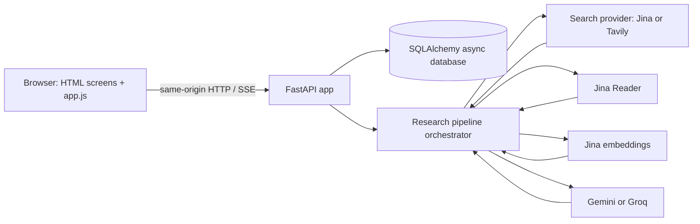
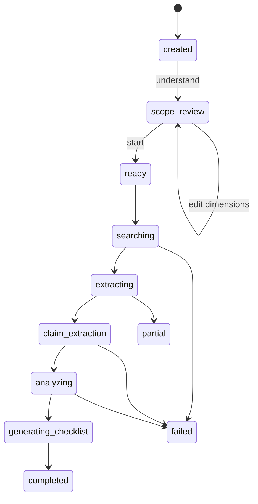

# GapLens architecture

This document describes the checked-in implementation as it exists today. It is a modular monolith: one FastAPI process serves the static interface, API, pipeline, and database access.

## System context

The browser is served from `frontend/html/` by FastAPI `StaticFiles`. The app mounts one origin for both UI and API, so the normal local flow does not require a separate frontend server or cross-origin requests.

## Code boundaries

| Path | Responsibility |
| --- | --- |
| `backend/app/main.py` | App lifecycle, logging, router inclusion, health/page routes, static frontend mount |
| `backend/app/api/research.py` | Research session HTTP routes, upload handling, scope and result serialization, SSE endpoint |
| `backend/app/schemas/` | Pydantic request/response models and enums |
| `backend/app/models/database.py` | SQLAlchemy entities and relationships |
| `backend/app/core/config.py` | Environment-backed settings |
| `backend/app/core/database.py` | Async SQLAlchemy engine, session dependency, startup table creation |
| `backend/app/pipeline/orchestrator.py` | Ordered research workflow and stage progress updates |
| `backend/app/services/` | Provider clients and analysis helpers |
| `frontend/html/` | Static screens and browser-side flow in `app.js` |

There are a few placeholder or overlapping package directories (`api/v1`, `pipelines`, `repositories`, `integrations`) alongside the active top-level implementation. The currently included router is `app.api.research`; the executing pipeline is `app.pipeline.orchestrator`. Do not infer that a package is active just from its name.

## Request and research lifecycle

1. `POST /api/research` validates the goal, persists a `ResearchSession`, and persists any URL inputs as pending `Source` rows. File references are not accepted in this request; uploads happen after session creation.
2. `POST /{id}/understand` runs goal interpretation and research dimension generation using the configured LLM. It saves the result in JSON columns and changes the state to `scope_review`.
3. `GET/PATCH /{id}/scope` returns and edits dimensions while the session is awaiting scope review.
4. `POST /{id}/sources/upload` extracts supported documents and stores their text. Accepted types: PDF, DOCX, TXT; max 10 MB each. Empty text PDFs are rejected; OCR is not present.
5. `POST /{id}/start` starts the post-review pipeline. The orchestration sequence is query planning, web search, source extraction, chunking/embedding, claim extraction, coverage analysis, contradiction detection, freshness analysis, evidence validation, gap prioritization, and verification checklist generation.
6. Results persist as relational entities and can be read as one combined response or through resource-specific endpoints.

The diagram abbreviates intermediate states. The enum in `schemas/research.py` is authoritative for all state names. Individual stages update session state and/or progress; a run can finish `partial` when errors or incomplete extraction occur.

## Pipeline and external services

`PipelineOrchestrator` owns the stage order and database writes. `services/external.py` provides clients for Tavily search, Jina search/reader/embedding, and structured LLM output through Gemini/Groq. Other service modules implement source, claim, conflict, gap, extraction, and verification logic. Provider selection and credentials are read from `app.core.config.settings`.

The `/health` response reports selected provider names and simple readiness booleans. It is not a provider connectivity check and does not prove that a live request will succeed.

## Progress delivery

The pipeline records progress in the module-level `ACTIVE_PIPELINE_PROGRESS` mapping. The events endpoint streams this process-local state to the browser. This works for a single process during local use; it is neither durable nor shared across workers. A process restart loses active progress, and multiple Uvicorn workers can disagree about the current event state. Production multi-worker execution needs a shared queue/progress store and a durable background job model.

## Persistence model

| Entity | Purpose | Main relationships |
| --- | --- | --- |
| `ResearchSession` | Original question, interpreted goal, dimensions, status and timestamps | Parent of sources, claims, gaps, conflicts, checklist items |
| `Source` | URL or uploaded document metadata and extracted content | Session; chunks and claims |
| `SourceChunk` | Chunk text, positions, token estimate, optional embedding | Source |
| `Claim` | Structured source-grounded statement and evidence metadata | Session and source |
| `Gap` | Missing/weak research coverage and recommended next step | Session; claim/source IDs held as JSON |
| `Conflict` | Pair of claims with a conflict classification | Session and two claims |
| `ChecklistItem` | Suggested verification task and completion state | Session |

The default connection is async SQLite (`sqlite+aiosqlite:///./gaplens.db`). `init_db()` creates tables on startup via SQLAlchemy metadata. This is not a migration system; schema evolution needs a deliberate Alembic migration workflow before relying on upgrades of persistent deployments.

## Architectural constraints and next steps

- **No authentication or tenancy:** session identifiers are not authorization. Add identity, ownership checks, and access control before exposing data beyond a trusted local environment.
- **Process-local pipeline:** use a durable worker/queue and shared progress transport for restarts or horizontal scaling.
- **SQLite default:** use persistent storage for a single-instance deployment or validate a managed database URL and migrations before scaling.
- **Source content retention:** full extracted documents and model-derived artifacts are stored in the database; define retention/deletion and backup policies for real deployments.
- **Provider variability:** preserve source excerpts and provenance, validate structured responses, and treat model-generated analysis as fallible.
- **No OCR:** scanned PDFs cannot be processed until OCR is added.

## Related docs

[API reference](../api/README.md) · [Data/security](../operations/security-and-data.md) · [Deployment](../operations/deployment.md) · [Product flow](../product/App_flow.md)
