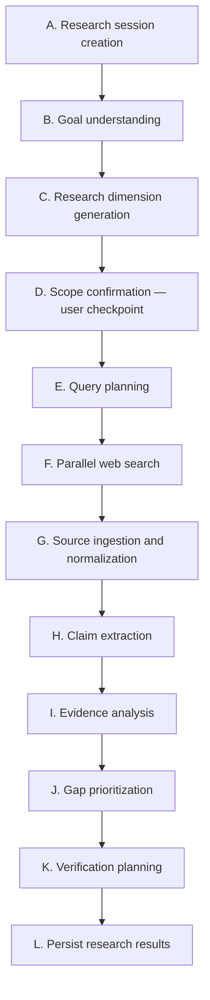
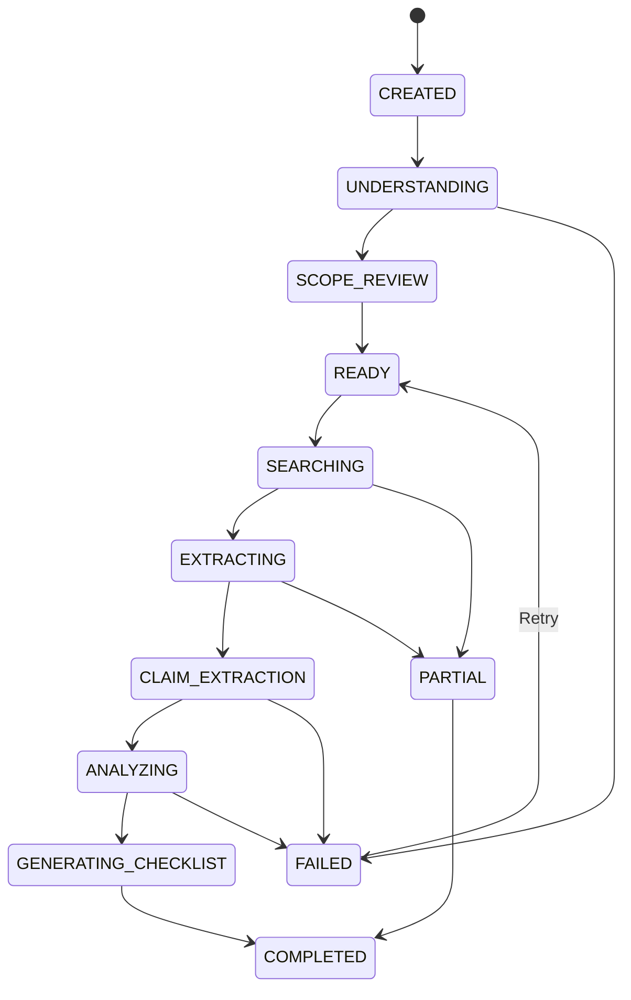
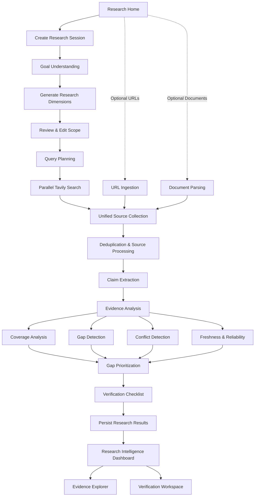

# GapLens AI — Final Product Flow & Backend–Frontend Architecture

> **Purpose:** Finalized product flow and frontend–backend architecture for GapLens AI, consolidating the decisions from the project discussion and comparing them with the existing backend blueprint.
>
> **Product positioning:** GapLens — AI Research Intelligence & Information Gap Analysis Engine  
> **Tagline:** See what's missing. Verify what matters.

---

## 1. Product direction

After comparing the previous backend plan, the GapLens implementation blueprint, and the proposed UI flow, the key architectural decision is:

**GapLens should be a research workspace powered by an automated evidence-analysis pipeline, not simply a web-search interface with an AI-generated report.**

The frontend must follow the backend's actual processing stages. Every screen should represent a meaningful user action, a backend operation, or a useful research result.

This document distinguishes:

- **Existing backend plan:** What had already been decided.
- **Refinement:** What needs to be clarified or added.
- **Final decision:** What should be implemented.

## 2. Comparing the previous backend plan with the proposed UI

The earlier backend architecture was a modular monolith:

| Layer | Previous decision |
|---|---|
| Frontend | Next.js, React, TypeScript, Tailwind CSS |
| Backend | FastAPI, Pydantic |
| Database | SQLite initially, sqlite-vec |
| Search | Tavily |
| Content extraction | Jina Reader |
| LLM | Gemini, Groq fallback |
| Deployment | Vercel + Railway |
| Architecture | Deterministic pipeline with selective LLM reasoning |

The original backend workflow was:

`Query → Understanding → Search → Extraction → Claims → Gap/Conflict Analysis → Report`

The more detailed implementation blueprint expanded this into a research pipeline with dimensions, multiple queries, source evaluation, evidence validation, and verification planning.

These two plans are compatible. The second is a more detailed implementation of the first.

### Where the UI flow needed correction

| Area | Previous UI proposal | Backend requirement | Final decision |
|---|---|---|---|
| Topic entry | Research Home | Query required | Keep |
| URL input | Home + Add Sources | Optional source ingestion | Keep one unified entry |
| Documents | Home + Add Sources | Dedicated parsers needed | Optional upload |
| Research scope | Not clearly defined | Query understanding and dimensions | Add scope review |
| Web search | Processing screen | Automatic Tavily search | Backend-driven |
| Source extraction | Processing screen | Jina Reader | Backend-driven |
| Claims | Not a separate UI stage | Structured claim extraction | Show progress and results |
| Gap analysis | Results | Coverage and missing information | Dedicated dashboard section |
| Conflicts | Results | Claim comparison | Dedicated dashboard section |
| Evidence | Separate page proposed | Source-linked claims | Use evidence drawer |
| Verification | Separate page | Verification checklist generation | Dashboard section |
| Adding more sources | Not fully defined | Requires additional ingestion and rerun | Add optional workflow |

The most important correction is that **scope generation, search execution, source processing, claim extraction and analysis must remain separate backend stages, even if the user sees them as one continuous research experience.**

## 3. The final backend workflow

This is the recommended execution architecture. It connects every frontend screen to the backend pipeline.

### Stage descriptions

**A. Research session creation**

FastAPI creates a research session and stores the original research query.

**B. Goal understanding**

Gemini interprets the query, identifies entities, objectives, scope, geography and time constraints.

**C. Research dimension generation**

Generate approximately 5–10 dimensions and identify what needs investigation.

**D. Scope confirmation — user interaction checkpoint**

Frontend displays generated dimensions. The user can edit, remove or add dimensions before research execution.

**E. Query planning**

Generate 2–3 targeted queries for each research dimension.

**F. Parallel web search**

Tavily discovers relevant web sources for each query.

**G. Source ingestion and normalization**

Jina Reader processes webpages, dedicated parsers process uploaded files, and URL ingestion handles user-provided links. Normalize and deduplicate sources.

**H. Claim extraction**

The LLM extracts claims, facts, dates, values and supporting excerpts, retaining source references.

**I. Evidence analysis**

Analyze coverage, evidence support, source reliability, freshness, contradictions and missing information.

**J. Gap prioritization**

Rank information gaps and conflicts by importance, impact and evidence quality.

**K. Verification planning**

Generate actionable verification questions and recommended next steps.

**L. Persist research results**

Save sources, claims, analysis, gaps, conflicts and checklist against the research session.

### Important architectural refinement

The pipeline should not be one enormous FastAPI endpoint that waits for everything to finish.

Instead:

- Create a research session.
- Execute pipeline stages through a background task.
- Persist stage status and intermediate results.
- Stream progress events to the frontend using SSE.
- Allow the frontend to reconnect and retrieve the current status.
- Store failures at the individual source or stage level so one failed webpage doesn't destroy the entire research session.

This will make the product more reliable during a hackathon demonstration.

## 4. Final UI flow — what the user actually experiences

### Account and workspace entry

The root route opens a small GapLens landing page. Users create an account or sign in before opening the research workspace. Authentication uses a signed, HTTP-only session cookie; every research session is owned by the account that created it. The home screen lists only that account's sessions, and API requests for another account's session return not found.

The recommended product has six primary screens, with an additional optional source-management workflow.

### Screen 01 — Research Home

**Purpose:** The user enters a topic, adds optional documents or URLs, and starts a research session.

**Backend connection:** Create research session and accept input sources.

**Visual reference prompt:** Modern minimal AI research workspace dashboard, dark navy and white interface, large central research prompt and optional file-upload cards.

> The earlier chat displayed an image preview for this screen, but did not expose its underlying image URL. The descriptive prompt is preserved here rather than inventing a URL.

### Screen 02 — Research Scope

**Purpose:** Display the AI-understood objective, research dimensions and proposed scope. Allow editing before execution.

**Backend connection:** Goal understanding and dimension generation.

**Visual reference prompt:** Modern research planning interface, editable research objectives, topic breakdown, checklist cards, clean SaaS dashboard.

> The earlier chat displayed an image preview for this screen, but did not expose its underlying image URL. The descriptive prompt is preserved here rather than inventing a URL.

### Screen 03 — Research in Progress

**Purpose:** Show the current stage, completed stages, sources found, extraction progress and any warnings.

**Backend connection:** Query planning through verification generation, streamed using SSE.

**Visual reference prompt:** Premium AI research progress dashboard, live stages, progress timeline, source discovery and analysis interface.

> The earlier chat displayed an image preview for this screen, but did not expose its underlying image URL. The descriptive prompt is preserved here rather than inventing a URL.

### Screen 04 — Research Intelligence

**Purpose:** Display the research overview, findings, coverage, gaps, conflicts and freshness.

**Backend connection:** Persisted research analysis and results.

**Visual reference prompt:** Professional AI analytics research intelligence dashboard, evidence coverage, information gaps, conflicting claims and data cards.

> The earlier chat displayed an image preview for this screen, but did not expose its underlying image URL. The descriptive prompt is preserved here rather than inventing a URL.

### Screen 05 — Evidence Explorer

**Purpose:** Open a claim to inspect its supporting excerpt, original source, metadata and other supporting or contradicting claims.

**Backend connection:** Claim, source and evidence retrieval.

**Visual reference prompt:** Modern evidence source explorer, side panel, document excerpt with highlighted citations, source metadata, SaaS interface.

> The earlier chat displayed an image preview for this screen, but did not expose its underlying image URL. The descriptive prompt is preserved here rather than inventing a URL.

### Screen 06 — Verification Checklist

**Purpose:** Show prioritized verification tasks, reasoning and completion status.

**Backend connection:** Verification task generation and status persistence.

**Visual reference prompt:** Clean professional task verification checklist dashboard, priority status, source links, research workspace.

> The earlier chat displayed an image preview for this screen, but did not expose its underlying image URL. The descriptive prompt is preserved here rather than inventing a URL.

These are six logical screens, not necessarily six different routes. Evidence Explorer should initially be a drawer, and the verification checklist can be a dashboard tab. This keeps navigation simple.

## 5. Screen 01 — How the research input should work

The user should never have to choose between web search, URL analysis or document analysis before starting research.

All three should be supported in one unified research composer.

### Research Home composer

**Heading:** What do you want to investigate?

**Supporting text:** Find missing information, uncover conflicting claims and discover what needs verification.

**Research topic \***

Example:

`GATE 2025 eligibility criteria and application process`

**Automatic web research — Included**

GapLens automatically discovers relevant sources.

**Additional sources (optional)**

- **Add URLs:** Official websites, articles and references.
- **Upload files:** PDF, DOCX and TXT.

**Reassurance:** All evidence is combined into one research workspace.

**Primary action:** Start Research

### Input behavior

| User action | Backend behavior |
|---|---|
| Topic only | Automatic web research |
| Topic + URLs | Web research + URL ingestion |
| Topic + documents | Web research + document parsing |
| Topic + URLs + documents | All inputs combined |

The original research topic remains mandatory.

## 6. How frontend and backend should communicate

We should define the API contract before implementing all screens.

The following is the recommended API design based on the previous FastAPI architecture. These are proposed endpoint contracts, not a claim that all endpoints already exist.

| Endpoint | Purpose |
|---|---|
| `POST /api/research` | Create research session |
| `POST /api/research/{id}/sources` | Add URLs and documents |
| `POST /api/research/{id}/understand` | Generate goal understanding and dimensions |
| `GET /api/research/{id}/scope` | Retrieve research scope |
| `PATCH /api/research/{id}/scope` | Update dimensions |
| `POST /api/research/{id}/start` | Begin research pipeline |
| `GET /api/research/{id}/events` | SSE progress stream |
| `GET /api/research/{id}/status` | Retrieve current pipeline status |
| `GET /api/research/{id}/results` | Retrieve research intelligence |
| `GET /api/research/{id}/sources` | Retrieve sources |
| `GET /api/research/{id}/claims` | Retrieve extracted claims |
| `GET /api/research/{id}/gaps` | Retrieve information gaps |
| `GET /api/research/{id}/conflicts` | Retrieve conflicting claims |
| `GET /api/research/{id}/checklist` | Retrieve verification checklist |
| `PATCH /api/research/{id}/checklist/{task_id}` | Update task status |

### Recommended session state machine

### Session lifecycle rules

- Individual source extraction failures should be recorded without necessarily failing the entire session.
- Partial results should be identifiable as partial, not presented as complete research.
- A completed session should retain its original sources and claims.
- Re-running research should create a new analysis version rather than silently overwrite previous findings.

## 7. The dashboard structure

The dashboard is the most important part of GapLens. It should not look like a conventional analytics dashboard filled with unrelated charts.

It should answer five questions:

1. What did we discover?
2. What information is missing?
3. What information conflicts?
4. Which evidence can we trust?
5. What should we verify next?

### Research workspace layout

**Research title example:** GATE 2025 Eligibility Criteria

**Research status:** Research completed · 12 sources · 8 dimensions

#### Overview metrics

| Metric | Example |
|---|---:|
| Sources analyzed | 12 |
| Research gaps | 4 |
| Conflicts detected | 2 |
| Claims extracted | 38 |

These are illustrative UI values, not actual research results.

#### Research sections

| Section | Purpose |
|---|---|
| Overview | Research summary and key findings |
| Coverage Analysis | Dimensions investigated and missing coverage |
| Information Gaps | Missing, incomplete or unsupported information |
| Conflicts | Contradictory claims across sources |
| Sources & Evidence | Source library and claim-level evidence |
| Verification Checklist | Prioritized verification tasks |

### Important: Evidence classification

Use the terminology from the project:

- **Verified:** Supported by sufficient reliable evidence under our verification rules.
- **Potential:** A gap, conflict or claim that has some supporting indication but needs further examination.
- **Uncertain:** Insufficient evidence or unresolved reliability.

Do not automatically label a claim verified just because an LLM extracted it from a webpage.

Also, keep source reliability, claim verification status and research gap severity as separate properties. They are not the same thing.

## 8. Features to include now versus later

For a hackathon, we need a realistic implementation boundary.

| Feature | Priority | MVP |
|---|---|---|
| Topic-based research | Critical | Yes |
| Automatic Tavily search | Critical | Yes |
| Goal understanding | Critical | Yes |
| Research dimensions | Critical | Yes |
| Editable scope | High | Yes |
| URL ingestion | High | Yes |
| PDF/DOCX/TXT ingestion | High | Yes, basic |
| Jina extraction | Critical | Yes |
| Claim extraction with citations | Critical | Yes |
| Coverage analysis | Critical | Yes |
| Conflict detection | Critical | Yes |
| Information gap detection | Critical | Yes |
| Freshness analysis | High | Yes, where dates exist |
| Verification checklist | High | Yes |
| SSE progress | High | Yes |
| Add sources after completion | Medium | Later |
| Re-run and compare versions | Medium | Later |
| Export PDF reports | Medium | Later |
| Collaborative workspaces | Low | Later |
| Agentic autonomous research | Not required | No |

## 9. Final architecture and user journey

## 10. Final decisions — GapLens product specification

### Product architecture

- Modular monolith with FastAPI backend.
- The six supplied HTML screens are served directly by FastAPI, with a shared browser JavaScript client calling the same-origin API.
- Deterministic pipeline with selective LLM reasoning.
- No agentic architecture in the MVP.

The earlier stack comparison in this document and the implementation blueprint records the original Next.js proposal. The current project decision replaces that frontend with the existing HTML templates served by FastAPI; the six-screen workflow and backend lifecycle below remain the product requirements.

### Input strategy

- Research topic is mandatory.
- Automatic web search is always included.
- URLs and documents are optional.
- All sources enter one unified evidence pipeline.

### Navigation

- Research Home.
- Research Scope.
- Processing.
- Research Intelligence.
- Evidence Explorer.
- Verification Checklist.

### Interaction strategy

- Scope confirmation before expensive research.
- Real-time backend progress.
- Clickable evidence references.
- Optional source additions in a later workflow.
- Persisted results and research status.

### Core product objective

Identify information gaps, contradictory claims, outdated information and insufficient evidence, then help the user determine what needs verification.

---

## 11. Final recommendation

**Lock this architecture and flow before generating further UI screens.** It preserves the previous backend decisions, introduces the missing frontend checkpoints, and avoids designing UI functionality that the backend cannot support.

The next implementation task should be to define the exact Pydantic request/response schemas and session lifecycle for Screen 01 and Screen 02. That will ensure the UI and FastAPI backend are developed together rather than independently.

---

## Appendix — Image reference note

The previous chat response used generated image previews for the six screen examples. The chat did not expose their original image URLs as reusable Markdown links. To preserve the same visual references without fabricating URLs, this document retains each original descriptive image prompt under its corresponding screen. These prompts can be reused to retrieve or generate replacement visual references.
